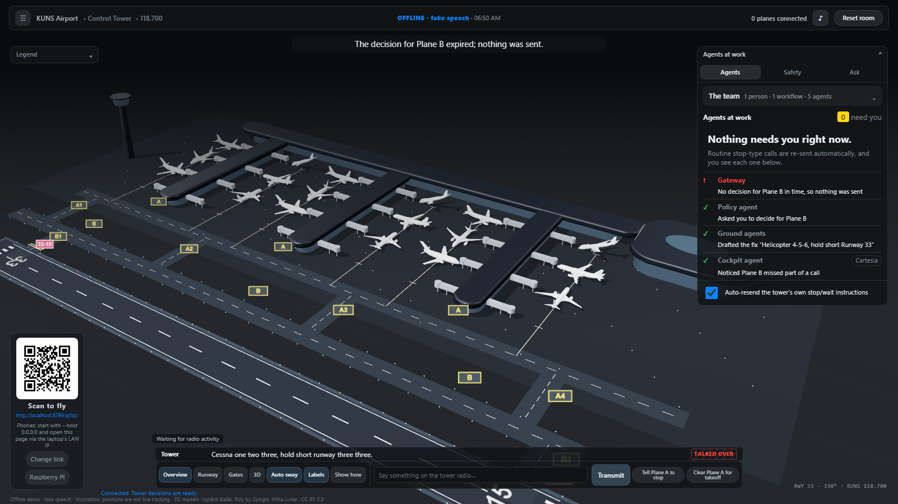
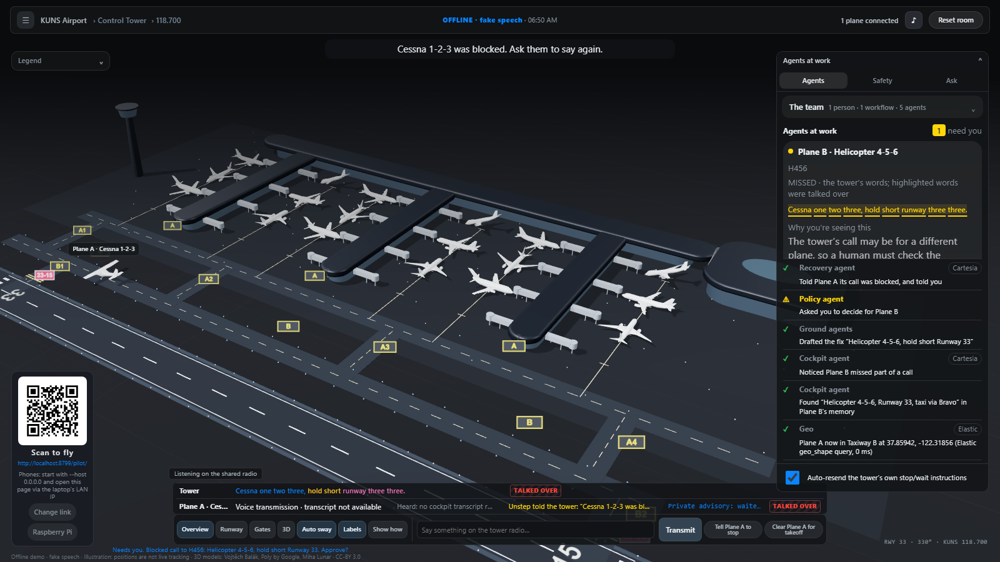
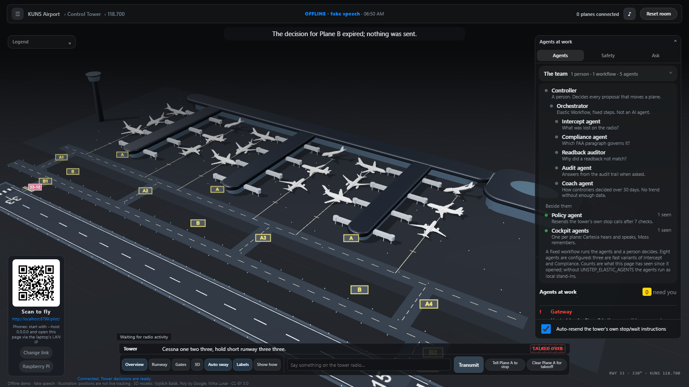
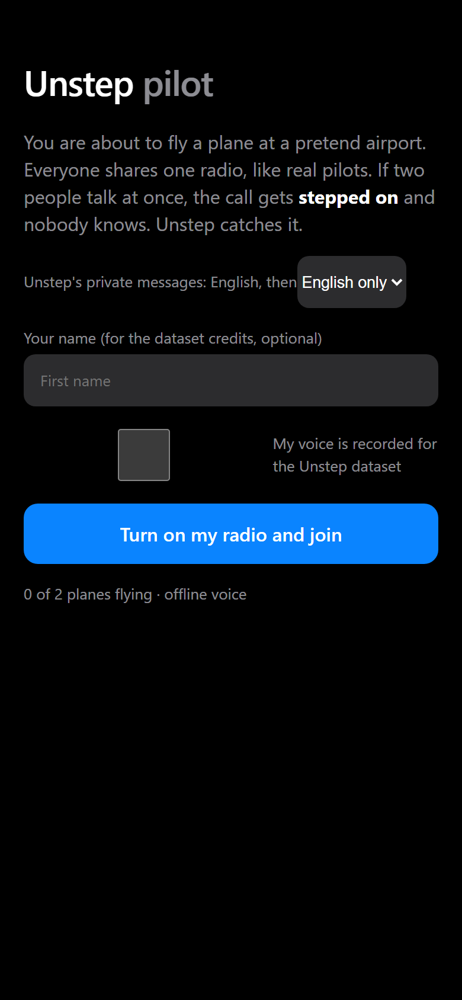
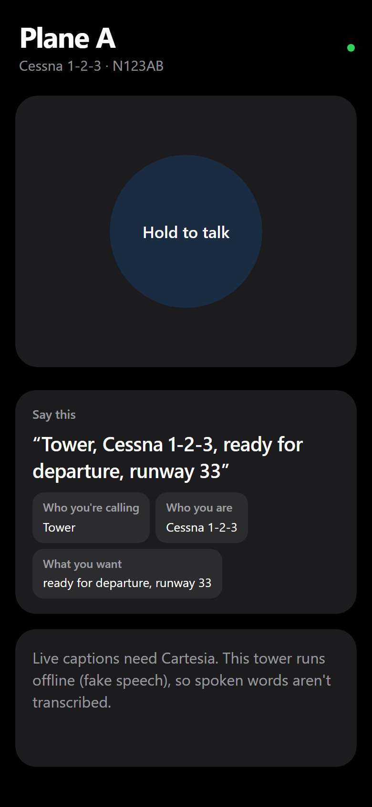
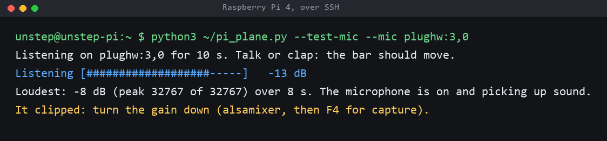

# Unstep

**Agentic air traffic control. A second set of ears for every controller.**

Unstep is a team of AI agents that works the radio *with* an air traffic controller. It listens to every transmission, catches calls that were stepped on, checks every readback, drafts the next clearance, speaks privately to the one pilot who needs it, and records every decision. **The controller approves everything; the agents never act alone.**

Built at Cal Hacks 13.0 with **Cartesia** (the ears and the voice), **Moss** (each aircraft's memory) and **Elastic** (the agent platform). Every number in this README was measured in our own runs. Where something is built but not yet measured live, we say so.

| | |
| --- | --- |
| Demo video | 2:58, linked from the Devpost submission; its source is in [`video/`](video/) (Remotion) |
| Try it | Scan the QR code on the ATC console and your phone becomes a plane ([Setup](#setup)) |
| Tracks | Cartesia · Moss · Elastic (Best use of the Elastic Agent Builder on a Serverless instance) |

---

## Contents

1. [The problem](#1-the-problem)
2. [What Unstep does](#2-what-unstep-does)
3. [One complete flow (the demo)](#3-one-complete-flow-the-demo)
4. [How it works](#4-how-it-works)
5. [**Cartesia**: the ears and the voice](#5-cartesia-the-ears-and-the-voice)
6. [**Moss**: each aircraft's memory](#6-moss-each-aircrafts-memory)
7. [**Elastic**: the agent platform](#7-elastic-the-agent-platform)
8. [The two screens](#8-the-two-screens)
9. [Measured results](#9-measured-results)
10. [Impact and responsible use](#10-impact-and-responsible-use)
11. [Setup](#setup)
12. [Testing](#12-testing)
13. [Known limitations](#13-known-limitations)
14. [Repo layout](#14-repo-layout)
15. [How we built it, and credits](#15-how-we-built-it-and-credits)

Also: [What it looks like](#what-it-looks-like) · [For the sponsors](#for-the-sponsors) · [Built in a day](#built-in-a-day)

---

## 1. The problem

Every flight is guided by a voice on the radio: an air traffic controller. The FAA handles about **45,000 flights a day**, and the people doing it are stretched thin:

- **Short-staffed.** The FAA is about **3,500 controllers short** of its own goal, "with many already on mandatory overtime and six-day weeks" ([Washington Examiner, Oct 2025](https://www.youtube.com/watch?v=n0zGNlVS0J8)).
- **At the busiest airports.** Washington Reagan National runs on **20 certified controllers where it should have 30** (NATCA via [FOX 5 DC](https://www.fox5dc.com/news/dca-air-traffic-controllers-working-six-day-weeks-due-staffing-gap)). The radar facility that guides Newark had **24 of 38** positions filled (FAA via [Fox Business](https://www.foxbusiness.com/politics/air-traffic-controllers-take-trauma-leave-after-close-calls-communication-failures-newark)).
- **For years.** The union describes controllers working "six days a week, 10 hours a day, for years at a time" ([CNN, Mar 2025](https://edition.cnn.com/2025/03/08/us/air-traffic-controllers-us-shortage)).
- **One person, two jobs.** At DCA on 29 January 2025, the tower had combined the helicopter and local positions. The NTSB found that raised workload ([NTSB](https://www.ntsb.gov/news/Testimony/Pages/Homendy-20260212.aspx)). Transportation Secretary Sean Duffy, on ABC: *"There is a level of risk that gets injected into the system when we have a controller that's doing two jobs instead of one."*

Pilots and controllers share **one half-duplex radio channel**: only one voice gets through at a time. When two people transmit at once, everyone else hears a squeal, and **neither speaker knows**. An FAA study found blocked, stepped-on or clipped calls in **1.16%** of transmissions at the five busiest US approach facilities, and "no alerting system was detected" for them ([FAA CAMI, DOT/FAA/AM-05/19](https://rosap.ntl.bts.gov/view/dot/58248/dot_58248_DS1.pdf)). At the NTSB hearing on the 2025 DCA midair, the tower operations manager was asked whether a controller can tell that a call was stepped on. His answer: **"There's nothing."** ([AIN](https://backend.ainonline.com/aviation-news/air-transport/2025-08-04/ntsb-dc-midair-hearing-panel-3-covers-frequency-issues))

An overloaded controller can't catch every missed word and every wrong readback alone. **Unstep is not a way to run a tower with fewer people.** It is the help the people already there don't have.

## 2. What Unstep does

| Job | What it does | Powered by |
| --- | --- | --- |
| **01 Listens** | Turns every transmission, tower and cockpit, into live text while people talk | **Cartesia** Ink-2 |
| **02 Catches** | Detects a call that was stepped on and recovers the words that were lost | **Moss** + **Cartesia** + our overlap detector |
| **03 Checks** | Compares every readback with the instruction; a wrong runway is flagged and **the aircraft does not move** until it's right | **Cartesia** Ink-2 + **Elastic** percolator rules |
| **04 Drafts** | Proposes the next clearance from the flight plan, the aircraft's last call and live runway occupancy, even before anyone asks | **Elastic** Agent Builder + `geo_shape` + **Moss** |
| **05 Speaks** | Speaks the recovered instruction privately to the one pilot who missed it, in the left ear, in their language | **Cartesia** Sonic |
| **06 Records** | Logs every decision for audit, answers questions about the shift, writes the shift briefing and a nightly review | **Elastic** (ES\|QL, Workflows, Agent Builder) |

**The controller approves everything.** Agents propose, cite and check. They never write an instruction and never grant permission. The only automatic action (re-sending the controller's own stop/wait words after a stepped-on call) has visible policy checks and an off switch, and is off in the demo.

## 3. One complete flow (the demo)

The laptop is the control tower on the projector. Phones are the planes: **scan the QR on the console and you're a pilot.** This is the flow in the demo video, recorded live on the real system (`scripts/capture_demo_footage.py`):

1. **Plane A asks for taxi.** The **Clearance agent** proposes *"Cessna 1-2-3, taxi to runway 33 via Bravo, hold short of runway 33"*:
   - the flight plan comes from **Elastic** (`unstep-flightplans`);
   - the aircraft's last tower call comes from its **Moss** session in under 1 ms;
   - "runway clear" comes from an **Elastic** `geo_shape` query.
   The controller taps **Send**, and **Cartesia** Sonic speaks it on the frequency.
2. **The pilot reads it back; only then does the aircraft move** (FAA JO 7110.65 ¶2-4-3, AIM 4-3). It taxis on the 3D airport and stops at the hold-short line.
3. **The tower says "Cessna 1-2-3, hold short runway 33", and at the same moment the helicopter keys up.** The Cessna's receiver carries two voices.
4. **Unstep catches it.**
   - The overlap detector flags the squeal; **Cartesia** Ink-2 shows what the cockpit actually heard.
   - **Moss** searches the Cessna's own memory with that garbled fragment and recovers "hold short runway 33".
   - **Elastic** matches the instruction to its FAA rule: ¶3-7-2, hold short is restrictive and must be read back.
   - A decision card appears: *"Plane A missed 'Cessna 1-2-3, hold short Runway 33'. Approve?"*
5. **The controller approves with one tap.**
6. **Only the Cessna hears it.** **Cartesia** Sonic speaks *"From Tower: Cessna one two three, hold short runway three three. Read back."* into the pilot's left ear, labelled "Only you · left ear" on the phone. The helicopter is told separately that its call was blocked.
7. **The pilot reads back; Unstep checks it:** *"Read back correct."*
8. **A new clearance, a wrong readback.** The pilot reads back "runway **13**". Unstep flags it, and the aircraft stays put. Corrected, it lines up.
9. **The agent proposes the next step unasked.** Lined up, runway clear: *"Cessna 1-2-3, runway 33, cleared for takeoff."* Sent, read back, airborne.

### What it looks like

All screenshots below are from our offline demo build (fake speech, so no API calls). The flow, the agents and the screens are the real code; the speech and timing numbers are in section 9.

#### The tower console



The controller's screen. The 3D airport shows every plane. The **QR code** (bottom left) is the one way in: a judge or customer scans it and their phone becomes a plane. The panel on the right is "Agents at work".

#### A call gets stepped on



The tower and Plane A talked at the same time, so both lanes at the bottom say **TALKED OVER**. The headline says what happened in plain English. The card on the right is the part that needs a person: **Approve and send** or **Reject**. Below it, the agents list what they did: the Elastic geo lookup (where the plane was), the Cartesia recovery agent (told Plane A its call was blocked), the policy agent (asked the controller to decide), the ground agents (drafted the fix) and the cockpit agent.

#### The team of agents



One person, one fixed workflow, five agents. The orchestrator is an Elastic Workflow with written-down steps: it sequences the agents and decides nothing. Only the controller approves anything that moves a plane.

#### A phone is a plane

| Join | In the air |
| --- | --- |
|  |  |

Scan the QR, tap once, hold the big button to talk. The card says what to say, so a judge who has never heard a radio call can do it.

#### A Raspberry Pi is a plane too



A Raspberry Pi 4 with a Logitech webcam microphone joins the same room as a pilot (`scripts/pi_plane.py`). The level bar shows the microphone is on and working, and the tool warns when the signal is too loud. This capture is from before the client began setting the microphone level itself, which is why it reports clipping. Only the Pi's microphone and network are in use today; the plane's decisions still run on the hub.

---

## 4. How it works

```mermaid
flowchart LR
  subgraph Radio["Radio · 118.700 (one shared channel)"]
    TWR[Tower mic]; A[Cessna radio]; H[Helicopter radio]
  end
  subgraph Cockpit["In each cockpit (on board)"]
    OD[Overlap detector] --> INKC[Cartesia Ink-2<br/>what the cockpit heard]
    INKC --> MOSS[(Moss session<br/>this aircraft's clearances)]
    MOSS --> REC[Recovered instruction]
  end
  subgraph Ground["Ground · ATC hub"]
    INKT[Cartesia Ink-2<br/>tower transcript, key terms] --> RULES[(Elastic percolator<br/>FAA JO 7110.65)]
    RULES --> WF{{Elastic Workflow<br/>Intercept ‖ Compliance agents}}
    REC --> WF
    WF --> CTRL[Controller approves]
    CTRL --> AUD[(Elastic audit · ES|QL · Kibana · MCP)]
    CLR[Clearance agent<br/>flight plan · geo_shape · Moss] -.-> CTRL
  end
  subgraph Back["Back to the cockpit"]
    SONIC[Cartesia Sonic<br/>private, left ear] --> RB[Pilot readback] --> CHK[Ink-2 + readback check] --> MOVE[Aircraft may move]
  end
  A --> OD; TWR --> INKT; H -.-> OD
  CTRL --> SONIC
  MOSS -. flight log on landing .-> MCLOUD[(Moss Cloud)]
```

**There is no "boss" agent.** Fixed code decides what a sentence is (an ordinary call, a stepped-on call, a readback, a question), and only the agents that event needs are called. The same sentence always takes the same path. A sentence reaches zero to two agents. ([docs/20-agent-map.md](docs/20-agent-map.md))

**Measured end to end (live):** from the end of a stepped-on call to the pilot hearing the fix, **2.9 s**, with the controller's approval included.

## For the sponsors

Who each sponsor is, what we think would impress them, and the numbers behind it. The detail for each is in sections 5 to 7.

### Built in a day

Every dataset and index below was created from scratch during the hackathon. First commit: **2026-10-23 21:00 PDT**.

| What landed | When (PDT) | Hours after the first commit |
| --- | --- | --- |
| Airport index script (Moss reference data, 8 documents) | 2026-10-24 00:12 | 3.2 |
| Elastic deploy script (agents, tools, workflows) | 2026-10-24 20:36 | 23.6 |
| FAA rulebook ingest (52 JO 7110.65 paragraphs) | 2026-10-24 21:07 | 24.1 |
| Traffic simulator: 500 labelled calls, 157 stepped on (simulated) | 2026-10-24 23:15 | 26.3 |
| **State at 2026-10-25 06:38** | 339 commits, 618 tests | 33.6 |

By then: **8 Elastic agents, 9 tools and 7 Workflows**, **14 named Elastic indexes** (listed in section 7), **7 stored rules** as percolator queries (one, paragraph 3-7-2, reviewed by a person; the others are marked candidate or needs review), **6 per-aircraft Moss sessions** plus an airport index and a flight-log index. The rulebook is 52 paragraphs, not all of JO 7110.65, and only one stored rule has been reviewed by a person so far.

---

### Cartesia: the ears and the voice

**What they are.** A real-time voice AI company: Sonic (text to speech) and Ink (speech to text), built for low-latency agents. [Cartesia changelog 2026](https://docs.cartesia.ai/changelog/2026).

**What would impress them** (our reading of their feedback in [docs/21](docs/21-sponsor-features.md); they asked for a list of the features they are proud of and how we use each):
- Their models working under a hard condition: shared-radio noise, callsigns, runway numbers, and a person's safety riding on the words.
- Measured gains from their own features, not just "we used it".
- Honest findings handed back to their team ([docs/09](docs/09-cartesia-feedback.md), [docs/24](docs/24-cartesia-findings.md)), including bugs that turned out to be ours.

**What we use:** Ink-2 streaming speech to text, key-term prompting, streaming captions, Sonic streaming speech, the same voice across languages, speed control, pronunciation dictionaries, and interrupting speech when the pilot keys the mic.

| Number | Value | Grade |
| --- | --- | --- |
| Tower transcript final after release | **155 ms** (was 2,702 ms) | LIVE |
| Cockpit transcript final after release | **172 ms** | LIVE |
| Sonic first audio | **85 to 201 ms** | LIVE |
| Key terms in heavy radio noise (200 lines) | callsign **62.5% to 95.5%**, runway **81.6% to 98.5%**, word error **0.191 to 0.009** | LIVE |
| Speech to text and back, 40 ATC lines | **100%** callsign, action and runway; every wrong readback caught | LIVE |
| Languages checked for the private advisory | Spanish, Hindi, French | LIVE |

**Limits we state.** Ink-2 sends no word timestamps and no interim results. Cartesia has an on-device Sonic in private beta ([Cartesia on-device](https://cartesia.ai/blog/on-device)); we use the cloud API and are not on it yet.

---

### Moss: each aircraft's memory

**What they are.** Real-time semantic search that runs inside an agent's own process, built for the speech, retrieval, language model, speech loop of voice agents. [Moss voice agents](https://www.moss.dev/use-cases/voice-agents).

**What would impress them** (from their feedback in [docs/21](docs/21-sponsor-features.md): they liked the startup angle, "a whole ecosystem", and wanted Moss-specific features and how Moss helps the voice side made explicit):
- An agent per aircraft with a memory per agent: a real ecosystem, not one demo query.
- Moss sitting inside every voice turn: Ink hears, Moss searches the plane's memory, Sonic speaks, with no audible delay.
- Many Moss features used for real reasons, each with a number.

**What we use:** one local session per aircraft, hybrid search, metadata filters and sorting, save to disk and load on restart, a cloud flight log pushed once when a plane lands, an airport reference index, and Moss Inference for translating the advisory.

| Number | Value | Grade |
| --- | --- | --- |
| A plane's last tower call | **0.29 to 0.56 ms** | LIVE |
| Search over 6 sessions | **0 to 1 ms** | LIVE |
| Right clearance vs unrelated speech (hybrid score) | **1.0** vs **0.0** | LIVE |
| Restart from disk | **21.1 ms** (4 documents, no duplicates) | LIVE |
| Flight log read back from Moss Cloud | about **1.2 to 1.5 s** (2 documents) | LIVE |
| Moss Inference, first token | about **165 ms** warm | LIVE |

**Limits we state.** The first lookup on a cold session was 783 ms against 0.2 to 0.4 ms warm, so we warm the planes before a demo. Opening a session contacts Moss's cloud, and we have not confirmed search keeps working with the network cut after the index loads.

---

### Elastic: the agent platform

**What they are.** The Elasticsearch company; Elastic Agent Builder, Workflows and ES|QL turn a search index into agents and automations. [Agent Builder](https://www.elastic.co/elasticsearch/agent-builder), [ES|QL for search](https://www.elastic.co/docs/solutions/search/esql-for-search).

**What would impress them** (from their feedback in [docs/21](docs/21-sponsor-features.md): ingesting a rulebook is "okay", but "not the greatest use of their products"; they want flagship features):
- Agent Builder used for real jobs with limits: each agent can only call its own fixed queries, so "least privilege by tool".
- Workflows doing the sequencing, including scheduled ones, so the agents are not a black box.
- ES|QL, percolator, geo and hybrid search each solving a tower task, not a document dump.
- A person approving every decision, with every event in the audit trail.

**What we use:** 8 Agent Builder agents and 9 tools; 7 Workflows (event-driven and scheduled); ES|QL with `INLINESTATS`; the percolator for readback matching; `geo_shape` and `geo_point` for where each plane is; hybrid search with a Jina reranker for the FAA citation; an MCP server for our tools; 14 indexes.

| Number | Value | Grade |
| --- | --- | --- |
| Percolator readback match | **3.0 ms** | LIVE |
| `geo_shape` area lookup | **0 to 1 ms** | LIVE |
| Reranked FAA citation | about **1.1 s** | LIVE |
| ES|QL safety panel | **1.1 to 1.5 s** | LIVE |
| End-to-end taxi and readback suite | **28 of 28** live checks | LIVE |
| FAA JO 7110.65 paragraphs indexed | **52** | LIVE |

**Limits we state.** An Agent Builder call takes about 5 to 10 s whatever the answer, so agents stay off the pilot's critical path: the decision card goes out at once and the citation is added when it arrives.

---

### Why this is credible

- Every number carries a grade, and simulated traffic is always labelled as simulated.
- The 500-call run ([docs/18](docs/18-benchmark.md)) is a simulation we generated ourselves, so it tests our detector against our own model of overlap, not against real radio. Its 91.7% of 157 stepped-on calls (0 false events on 343 clean calls) is a regression check. Against 0% today (the FAA found no alerting system for stepped-on calls) it shows the detector works on the cases we model; it is not a field accuracy.
- We say what is not built or not measured: recorded sessions with real people, real air traffic recordings, and the camera-cover push to talk on the Pi.

---

## 5. Cartesia: the ears and the voice

On a radio, everything is voice. Cartesia hears the whole frequency in real time and speaks privately to exactly the right person, in their language. Code: [`unstep/cockpit/stt.py`](unstep/cockpit/stt.py), [`unstep/cockpit/tts.py`](unstep/cockpit/tts.py), [`unstep/ground/tower.py`](unstep/ground/tower.py), [`unstep/live/room.py`](unstep/live/room.py).

### Every Cartesia feature we use

| Cartesia feature | How Unstep uses it | Where | Measured (live) |
| --- | --- | --- | --- |
| **Ink-2 streaming speech-to-text** | Every transmission is transcribed *while the key is held*, for the tower and for what each cockpit hears (each cockpit gets its own live mix of the frequency) | `CartesiaManualSTT`, `TowerStream` | Tower transcript final **155 ms** after release (was 2,702 ms before streaming); cockpit **172 ms** |
| **Manual finalize** | The transcript is finalized the moment the transmitter is released | `CartesiaManualSTT.finalize` | 0 of 15 over 800 ms in a repro run |
| **Key-term prompting** | **39 aviation terms per cockpit**, most important first, within Cartesia's limits (100 terms, 1,200 characters): the aircraft's callsigns, critical phrases ("hold short", "line up and wait", "cleared for takeoff", "go around"), runways, taxiways, ATC words ("niner", "tree", "fife", "squawk", "NOTAM") | `build_keyterms` | Heavy radio noise: callsign **62.5% → 95.5%**, runway **81.6% → 98.5%**, word error rate **0.191 → 0.009** |
| **Streaming text during speech** | Live captions on the projector and on every phone, with key words marked (callsign, action, runway) and the lag shown | `on_text`, `settle_caption` | Captions arrive before release; final **97 ms** after; the phone shows "Cartesia live caption · ~100 ms behind speech" |
| **ink-whisper word timestamps** | A second paced stream gives word times, so the console strikes out exactly the tower words lost in the overlap | `TowerTranscriber` | |
| **Turns endpoint** (`turn.start` / `turn.end`) | Readbacks and pilot questions; `turn.start` interrupts the advisory | `CartesiaTurnSTT` | |
| **Sonic-3.6 text-to-speech, streamed** | The private advisory, streamed to the phone from the first chunk; the tower's typed instructions spoken on the frequency; the controller's audio prompt ("Needs you… Approve?") | `CartesiaTTS` | First audio **85–201 ms** |
| **Same voice, other languages** | The advisory repeated in **Spanish, Hindi or French** in the same voice, for pilots who choose a language | `unstep/cockpit/translate.py` | Checked live (es, hi, fr) |
| **Pronunciation dictionary** | ATC words said the ATC way ("tree", "fife"), uploaded once ([`assets/pronunciation/atc.json`](assets/pronunciation/atc.json)) | `scripts/upload_pronunciation_dict.py` | Every entry passed a speech-to-text round trip (below) |
| **Speed control** | "Readback incorrect" corrections are spoken slower | 0.85× | |
| **Context cancel / interruption** | The advisory stops the moment the pilot keys the mic, and replays cleanly from the start | `CartesiaTTS.cancel` | |
| **Word timestamps on TTS** (`add_timestamps`) | Collected per word, for word-by-word display | `CartesiaTTS.speak` | |
| **Left-ear output** | Advisories play in the left ear only, so they never sound like the radio | `to_left_stereo` | |

### How we tuned and tested it (we did not train Cartesia's models)

- **A 200-transmission live benchmark** through a simulated VHF radio channel, three voices, several noise levels, with 95% confidence intervals (`scripts/eval_bench.py --live`). Results are in the table above and [docs/18-benchmark.md](docs/18-benchmark.md).
  - Clean audio: callsign 100%, runway 100%.
  - Heavy noise (radio-5): callsign 94.5%, runway 98.5%.
  - Stepped-on detection: **100% caught, 0 false alarms** on clean audio, 380 ms.
- **A TTS → STT closed loop over 40 ATC lines:** every line Sonic says goes back through Ink-2. **Live: callsign, action and runway 100%, every wrong readback caught, zero false alarms.**
- **The loop caught our own mistake.** We had respelled "niner" as "NY-ner" in the pronunciation dictionary. Sonic then said something like "N-one-er", and Ink-2 heard "N1er" or "and liner". Runway accuracy was 85% with the entry and 100% without it. We removed it, and now **every dictionary entry must pass a round trip**. "fower", "juliett" and "NOTAM" were rejected the same way ([`assets/pronunciation/rejected.json`](assets/pronunciation/rejected.json)).
- **Cartesia feedback:** what we found, what we worked around, and what we can truthfully report ([docs/09-cartesia-feedback.md](docs/09-cartesia-feedback.md), [docs/24-cartesia-findings.md](docs/24-cartesia-findings.md)).

## 6. Moss: each aircraft's memory

The cockpit already heard half the call. Moss finds the rest in the aircraft's own memory, in under a millisecond, without leaving the plane. Each cockpit agent's loop is **Cartesia Ink hears → Moss searches the plane's memory → Cartesia Sonic speaks**. Moss sits in the middle of every voice turn and adds no audible delay. Code: [`unstep/cockpit/memory.py`](unstep/cockpit/memory.py), [`unstep/cockpit/hint.py`](unstep/cockpit/hint.py), [`unstep/cockpit/queries.py`](unstep/cockpit/queries.py), [`unstep/live/flightplans.py`](unstep/live/flightplans.py).

| Moss feature | How Unstep uses it | Measured (live) |
| --- | --- | --- |
| **One local, in-process session per aircraft** (`flight-<callsign>`) | Every clearance, call heard and readback is indexed in that aircraft's own memory, on board, with no cloud index | 6 sessions; reads **0.2–0.4 ms** warm; search over 6 sessions 0–1 ms |
| **Hybrid search** (`alpha`, meaning + exact words) | The garbled fragment the cockpit heard ("Cessna 123, short runway 30") finds the right clearance | Right clearance scores **1.0**, unrelated speech **0.0** (below our floor) |
| **Metadata filters and sorting** | Only this aircraft, only tower calls, newest first: the Clearance agent's "last tower call", skipping calls to other aircraft | **0.29–0.56 ms** |
| **Answers from memory in the voice loop** | A pilot asks "Unstep, what was my last clearance?" or "what did the tower tell me in the last minute?"; Moss answers and Sonic speaks it | Under **1 ms** |
| **Save to disk and load on restart** (`save_to_disk`, `load_from_disk`) | An aircraft's memory survives a restart with no download | 4 docs restored in **21.1 ms**, no duplicates; correct answer after restart |
| **Moss Cloud sync** (`flightlog-<frequency>`) | When a plane goes quiet it lands, and its flight log is pushed once to Moss Cloud; a fresh client reads it back | 2 docs back in about **1.2–1.5 s**; survives restarts |
| **Persistent cloud index** (`airport-KUNS`) | Airport reference data, created once (`scripts/ingest_airport.py`) and loaded at start | |
| **Moss Inference** | Translates the private advisory; a translation is used only if every digit survives, otherwise English only | ~165 ms to first token, warm |

**Safety rules on Moss hints:** a hint only ever says stop or wait (hold short, go around), never "cleared". An older clearance can never come back ahead of a newer one. No source record means no hint. The newest clearance gives the hint, and Moss's search result is shown as the evidence, with its score and time.

Verify with `python scripts/moss_live_check.py` (prints `ok`). Deeper notes: [docs/23-moss-max.md](docs/23-moss-max.md).

## 7. Elastic: the agent platform

The rulebook, the flight plans, the airport map and every decision live in one place, and the agents act on them. Everything runs on an **Elastic Serverless** project, deployed from code with `python scripts/deploy_elastic.py`. Definitions: [`elastic/`](elastic/). Code: [`unstep/ground/`](unstep/ground/).

### Agent Builder: 8 agents (configured over our own indexes, not trained)

| Agent | Job | Tools it can call |
| --- | --- | --- |
| `unstep-intercept` | Confirms the tower really said the lost words | `unstep_recent_blocked_calls` |
| `unstep-compliance` | Cites the FAA JO 7110.65 paragraph and says whether the instruction is restrictive | `unstep_faa_search` |
| `unstep-intercept-lite`, `unstep-compliance-lite` | Fast variants that take the pre-fetched rule as input (no tool calls), used in the parallel workflow | none |
| `unstep-ground` | One-call version of both jobs | none |
| `unstep-readback-auditor` | Explains why a readback did not match, with the paragraph | `unstep_faa_search`, `unstep_readback_history` |
| `unstep-audit` | Answers the controller's questions about the shift from the audit trail ("which aircraft had the most blocked calls?"), showing its ES\|QL | 5 audit tools |
| `unstep-coach` | Reports how controllers decided on proposals over 30 days, and only claims a trend with enough data | `unstep_trend_decisions` |

**Least privilege by tool.** Every tool is a stored ES\|QL query or index search with a fixed shape: an agent fills in parameters (a callsign, an event id) and cannot run a free-form query. Agents never write to the audit trail.

### 9 tools

`unstep_faa_search`, `unstep_recent_blocked_calls`, `unstep_readback_history`, `unstep_trend_decisions` (ES\|QL with `INLINESTATS`), `unstep_audit_blocked_by_callsign`, `unstep_audit_blocked_per_minute`, `unstep_audit_readback_outcomes`, `unstep_audit_auto_resends`, `unstep_audit_landed_flights`.

### 7 Workflows (event-driven and scheduled)

| Workflow | Trigger | What it does |
| --- | --- | --- |
| `unstep-blocked-call` | Every stepped-on call | Runs Intercept and Compliance agents in **parallel** (the default path), stores the result |
| `unstep-blocked-intercept`, `unstep-blocked-compliance` | Parallel branches | One agent each, writing its own answer document |
| `unstep-blocked-call-fast` | Alternative | One agent call, given the pre-fetched rule |
| `unstep-readback-audit` | Every wrong readback | The Readback Auditor explains the mismatch; findings saved to `unstep-findings` |
| `unstep-briefing` | **Scheduled every 8 h**, and on demand | Shift handoff briefing from the last hour of the audit trail, saved to `unstep-briefings` |
| `unstep-nightly-review` | **Scheduled daily**, and on demand | The coach agent reviews 30 days of controller decisions, saved to `unstep-reviews` |

The console's **Shift briefing** and **Nightly review** buttons show the newest report and can run one now.

### Search, rules, geo, analytics

| Elastic feature | How Unstep uses it | Measured (live) |
| --- | --- | --- |
| **Percolator** (`unstep-rules`) | Each rule is a stored query: an instruction or readback is matched to its rule in one call | Readback matched in **3.0 ms**; rule lookup flat at 1–2 ms up to 5,000 rules |
| **Hybrid search + Jina reranker** (`unstep-faa`) | Finds the exact FAA JO 7110.65 paragraph to cite on every decision card, labelled as a search result | Reranked citation in about **1.1 s** |
| **`geo_shape` + `geo_point`** (`unstep-airport`, `unstep-positions`) | The airport's runway, hold-short areas and taxiways are shapes; every aircraft's position is a point, posted once a second. One `_msearch` says which area each plane is in; the Clearance agent asks "is the runway clear?"; the console flags a **runway incursion** | Elastic `took` **0–1 ms**; runway check 4–5 ms round trip |
| **Flight plans** (`unstep-flightplans`) | The Clearance agent reads each aircraft's plan (runway, route) | 0.23–2.0 s uncached |
| **Kibana Maps** | A live map of the airport shapes and plane tracks, coloured by aircraft | Deployed via the saved-objects import API (works on Serverless) |
| **ES\|QL** | Live safety analytics on the console (blocked calls, readback errors caught, auto-resent calls) and every audit tool | Panel answers in 1.1–1.5 s |
| **MCP server** (`/api/agent_builder/mcp`) | Our tools are callable from any MCP client (`scripts/mcp_demo.py`) | Lists the tools; `unstep_trend_decisions` returned real rows (24 Oct: 43 approved, 2 rejected) |
| **Every event stored** (`unstep-events`, `unstep-proposals`, `unstep-clearances`, `unstep-policy`, `unstep-flights`) | The audit trail of every call, proposal, decision and landed flight; simulated traffic goes to `unstep-sim-events`, labelled | |

**The hold-short rule was reviewed by a person**, not just picked by search: FAA JO 7110.65 **¶3-7-2** holds the requirement Unstep enforces: *"Request a read back of runway hold short instructions when it is not received from the pilot."* ¶3-7-4 is recorded as related.

**Agents stay off the pilot's critical path.** An Agent Builder call takes about 5 or 10 s whatever the answer length (measured over 13 calls), so the decision card goes out at once from the local check, and the agents' citation is added to the open card when it arrives (about 10–11.5 s). The instruction never changes, and confidence can only go down. Deeper notes: [docs/19-elastic-moss-plan.md](docs/19-elastic-moss-plan.md), [docs/25-latency-ideas.md](docs/25-latency-ideas.md).

## 8. The two screens

**ATC console** (`/live/atc/`, [`web/live/atc/`](web/live/atc/)), for the controller:
- **A 3D digital twin of the airport** (three.js): runway 33/15, taxiways A and B, connectors A1–A4, B1, B2, hold-short lines, terminal and parked aircraft. Planes queue on taxiway B, taxi along real routes, line up at the runway end, and take off.
- **Readback-first movement:** an instruction alone moves nothing; the aircraft moves only after a correct readback. "Hold position" acts at once.
- **"Agents at work" feed:**
  - green rows for what the agents did, amber for what needs a decision, red for what's wrong;
  - each row names the agent and the sponsor technology behind it;
  - **decision cards** for stepped-on calls and **Clearance agent cards**, each with what the agent checked and why.
- **Radio panel** with live captions per station and "TALKED OVER" marks.
- **Ask tab:** ask the audit agent about the last hour, or the coach about 30-day trends, with the ES\|QL shown. **Shift briefing** and **Nightly review** buttons.
- **Safety tab:** ES\|QL analytics. **"Show how":** the step-by-step evidence for an event, with a timing waterfall.
- **QR card** for walk-up pilots, a **Reset room** button, an auto-resend switch (off by default) and an optional tower password.

**Pilot app** (`/pilot/`, [`app/`](app/), React), the pilot's EFB:
- **Hold to talk** on the shared frequency.
- A **"Read it back" guide** that says what to say and whether the readback was right.
- **Live captions**, private advisories marked **"Only you · left ear"**, and a language choice.
- **Rejoins the same aircraft** after the phone sleeps.

## 9. Measured results

All live, on our own services and laptop. Simulated traffic is always labelled as such.

| What | Result |
| --- | --- |
| Call end → pilot hears the fix (controller approval included) | **2.9 s** |
| Tower transcript final after release (Cartesia Ink-2, streaming) | **155 ms** (was 2,702 ms) |
| Cockpit transcript final after release | **172 ms** |
| Sonic first audio | **85–201 ms** |
| Key terms in heavy radio noise | Callsign 62.5% → **95.5%**, runway 81.6% → **98.5%**, WER 0.191 → **0.009** |
| Stepped-on detection (benchmark) | **100%** caught, **0** false alarms on clean audio |
| TTS → STT loop, 40 ATC lines | **100%** callsign, action, runway; every wrong readback caught |
| Moss: aircraft's last tower call | **0.29–0.56 ms** |
| Moss: restart from disk | **21.1 ms** |
| Elastic: percolator readback match | **3.0 ms** |
| Elastic: `geo_shape` area lookup | **0–1 ms** (took) |
| End-to-end taxi and readback suite (`scripts/e2e_taxi.py`) | **28/28** live checks |

## 10. Impact and responsible use

- **A person decides.** Every instruction that lets an aircraft move waits for the controller's approval. The only automatic re-send is the controller's own stop/wait words, with visible checks and an off switch.
- **Hints only ever say stop or wait,** and only with a source record. Permissive instructions are never hinted.
- **Agents never write an instruction.** The words come from the controller's own transmission. Agents cite, check and flag; they can only lower confidence.
- **Never mistaken for ATC.** Every advisory starts with "Advisory", in a distinct synthetic voice, in the left ear. We don't clone controllers' voices.
- **Only the Unstep key commands Unstep.** Speech on the frequency is transcribed but never obeyed.
- **Privacy.** Each advisory goes only to the pilot who missed the call. Aircraft memories stay on board. Keys stay in `.env` (never committed); the hub supports a room token and a tower password.
- **Accessibility.** Live captions on every screen; advisories in the pilot's language; a readback guide that shows what to say; readback checks help pilots under high workload.
- **What we do not claim.** We haven't tested this in a real facility. We don't claim any effect on staffing, workload or incidents.

## Setup

### Requirements

Python 3.12, Node 22, and optionally FFmpeg. Keys for Cartesia, Moss and Elastic are needed for the live system; **everything also runs offline with labelled fakes**.

```bash
python -m venv .venv && source .venv/bin/activate   # Windows: .venv\Scripts\activate
pip install -r requirements.txt
cd app && npm install && npm run build && cd ..      # the pilot app the hub serves at /pilot/
cp .env.example .env                                 # fill in keys; never commit .env
```

| Key | Used for |
| --- | --- |
| `CARTESIA_API_KEY`, `CARTESIA_VOICE_ID` | Ink-2, ink-whisper and Sonic |
| `CARTESIA_PRONUNCIATION_DICT_ID` | The ATC pronunciation dictionary (from `scripts/upload_pronunciation_dict.py`) |
| `MOSS_PROJECT_ID`, `MOSS_PROJECT_KEY` | Moss sessions, Moss Cloud, Moss Inference (local fallback without them) |
| `ELASTIC_CLOUD_URL`, `ELASTIC_API_KEY`, `KIBANA_URL` | Elastic Serverless project and its Kibana |
| `UNSTEP_ELASTIC_AGENTS=1` | Call the Agent Builder agents (otherwise local stand-ins) |
| `UNSTEP_ATC_PASSWORD` | Optional tower password |

### Run it

```bash
python -m unstep.live --offline        # no keys: fake speech, local memory and rules
python -m unstep.live                  # live: Cartesia, Moss and Elastic
```

- **Tower:** open `http://127.0.0.1:8765/live/atc/`.
- **Plane:** open `http://127.0.0.1:8765/pilot/` in a phone-sized window.
- **Phones over the internet, one scan:** run `python scripts/demo_public.py`. It starts a Cloudflare quick tunnel with a real HTTPS certificate, sets the hub's public address, and puts the QR code on the console. Phone microphones need HTTPS, which the tunnel provides.

### One-time setup per account

```bash
python scripts/upload_pronunciation_dict.py      # Cartesia: uploads assets/pronunciation/atc.json, prints the id
python scripts/ingest_faa.py --source data/faa   # Elastic: FAA JO 7110.65 paragraphs into unstep-faa
python scripts/deploy_elastic.py                 # Elastic: indexes, tools, agents, workflows (--replace to update)
python scripts/deploy_elastic.py --only maps     # Elastic: the Kibana map
python scripts/ingest_airport.py                 # Moss: the airport-KUNS cloud index
```

### Check each sponsor live

```bash
python scripts/cartesia_live_check.py    # caption cadence, turns pacing, TTS first audio, dictionary round trip, 429 handling
python scripts/eval_bench.py --live      # the 200-transmission radio-noise benchmark
python scripts/moss_live_check.py        # fragment search, flight log survives restart, restore from disk
python scripts/mcp_demo.py               # Elastic Agent Builder tools over MCP
python scripts/verify_wired.py           # the wired pieces, end to end
```

## 12. Testing

```bash
python -m pytest -q          # Python: hub, agents, rules, geo, Moss, Cartesia clients, console logic (offline, with fakes)
cd app && npx vitest run     # pilot app
python scripts/e2e_taxi.py   # live end-to-end: needs a hub on port 8796
```

Latest run: **596 Python tests** (1 skipped) and **31 pilot-app tests** passing. The live end-to-end suite passes **28/28**. It covers:
- queueing;
- both runway ends;
- a wrong readback held;
- taxi via Alpha;
- hold position;
- the Clearance agent with Elastic flight plans and the geo runway check;
- the unasked takeoff proposal.

## 13. Known limitations

- **Overlap detection is narrow.** It finds the heterodyne squeal, not a second voice. A full overlap, where the stronger signal captures the receiver, can't be detected from audio alone. Comparing tower and cockpit transcripts is the reliable signal.
- **Readback false alarms in noise.** In heavy noise, 25% of correct readbacks were flagged as wrong. That's the safe direction (an extra correction), but worse than the published HAAWAII lab figure of 11%.
- **Sonic speaks slower than a controller:** about 3.5 syllables per second against a median 6.1 (Nitta, Okazaki and Klinger 2011). A 13-syllable clearance takes about 3.7 s instead of 2.1 s. First audio is fast; the phrase is long.
- **Cartesia gaps we worked around:**
  - Ink-2 has no word timestamps, so tower word times need a second ink-whisper stream.
  - ink-whisper has no key terms.
  - A slow finalize tail and some hung handshakes were seen once, late at night, and not reproduced at midday.
  - About 2 in 25 turns runs ended with an empty `turn.end`; we retry once.
  - Details: [docs/24-cartesia-findings.md](docs/24-cartesia-findings.md).
- **Agent Builder latency.** The agents take about 10–11.5 s per call, so their citation arrives after the card. Nothing on the pilot's path waits for them, except one case: a restrictive, high-confidence proposal that policy might auto-relay waits so Intercept can veto it.
- **One API key for all agents.** Separation is by tool, not by per-agent permission.
- **The airport is a demo map, not a survey.** Positions are scene coordinates mapped onto real latitude and longitude.
- **Readback parser is rule-based.** It compares callsign, action, runway and taxiway; unusual phrasing can be misread.
- **Moss free plan:** three indexes per project, so old test indexes have to be deleted.
- **Simulator, not avionics.** Phones and a laptop stand in for radios. Nothing here is certified, and it has not been tested in a real facility.

## 14. Repo layout

| Path | What |
| --- | --- |
| [`unstep/live/`](unstep/live/) | The live hub (FastAPI, WebSockets): the room, routing, geo, flight plans, QR join |
| [`unstep/cockpit/`](unstep/cockpit/) | Cockpit agent: overlap detector, Cartesia STT/TTS, Moss memory, hints, readbacks, translation |
| [`unstep/ground/`](unstep/ground/) | Ground agents: Elastic agents client, rules (percolator), FAA citation, reports, audit chat |
| [`unstep/gateway/`](unstep/gateway/) | WebSocket gateway, routing, policy, event sink |
| [`web/live/atc/`](web/live/atc/) | ATC console: 3D airport, taxi routing, instruction parser, Clearance agent rules, feed |
| [`app/`](app/) | Pilot app (React) |
| [`elastic/`](elastic/) | Agent Builder agents, tools, workflows, rules, Kibana map |
| [`scripts/`](scripts/) | Deploys, live checks, benchmarks, end-to-end suite, demo capture |
| [`video/`](video/) | The demo film (Remotion) |
| [`docs/`](docs/) | PRD, architecture, research, benchmarks, sponsor notes, Cartesia feedback |
| [`tests/`](tests/) | Python tests |

## 15. How we built it, and credits

Two people, Rishit and Deekshith, each working with a coding agent:
- **Split:** one side built the controller console, the other the pilot app and the hub.
- **Coordination:** the two agents agreed every change by Markdown "mail" on a Git branch (`agent-mail`), with a shell watcher, not a model, checking for replies.
- **Rules:** neither side edits the other's files without asking. Nothing is quoted as measured unless it was run live.

**Credits:**
- **3D aircraft:** Poly Pizza (CC-BY), see [`web/live/atc/models/CREDITS.md`](web/live/atc/models/CREDITS.md).
- **Typefaces in the film:** B612 (Airbus) and Archivo.
- **Music in the film:** ArctSound, raspberrymusic and Pastichio_Piano_Music (Pixabay).
- **News footage in the film:** ABC News, the Washington Examiner and local news reports.

**Built with:** Cartesia (Ink-2, ink-whisper, Sonic-3.6), Moss (sessions, Moss Cloud, Moss Inference), Elastic (Agent Builder, Workflows, ES\|QL, percolator, Jina rerank, geo, Kibana Maps, MCP), Python, FastAPI, WebSockets, React, three.js, Playwright, Remotion.
