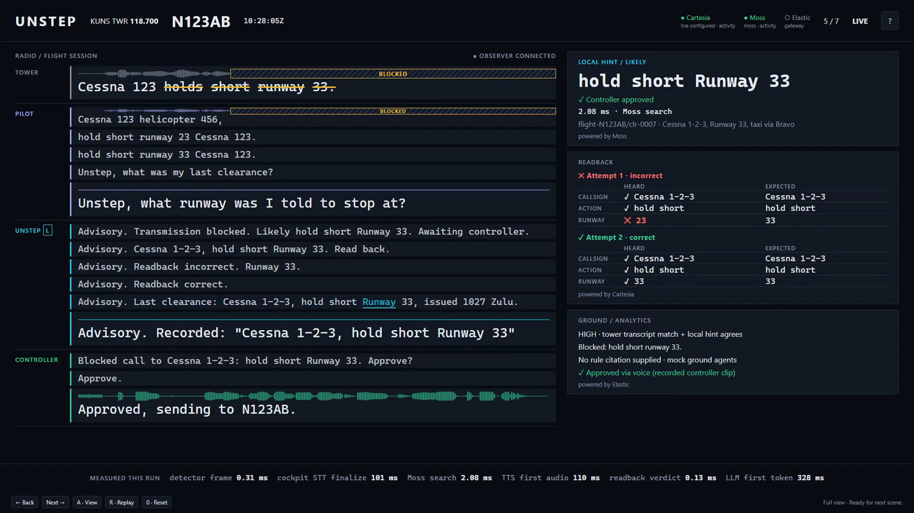
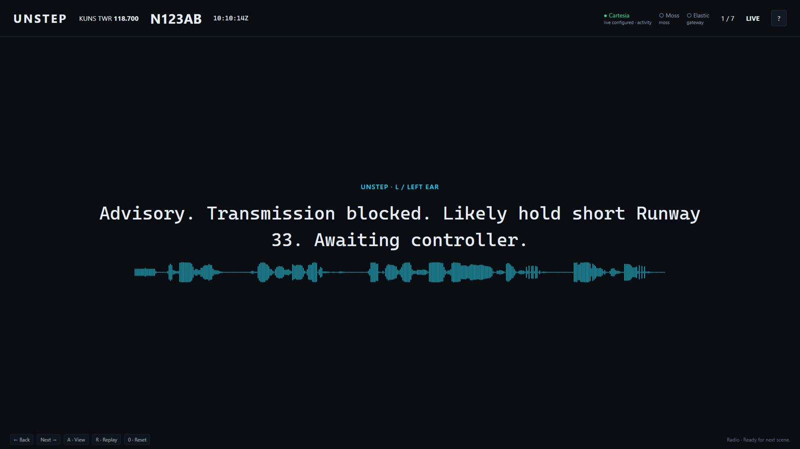
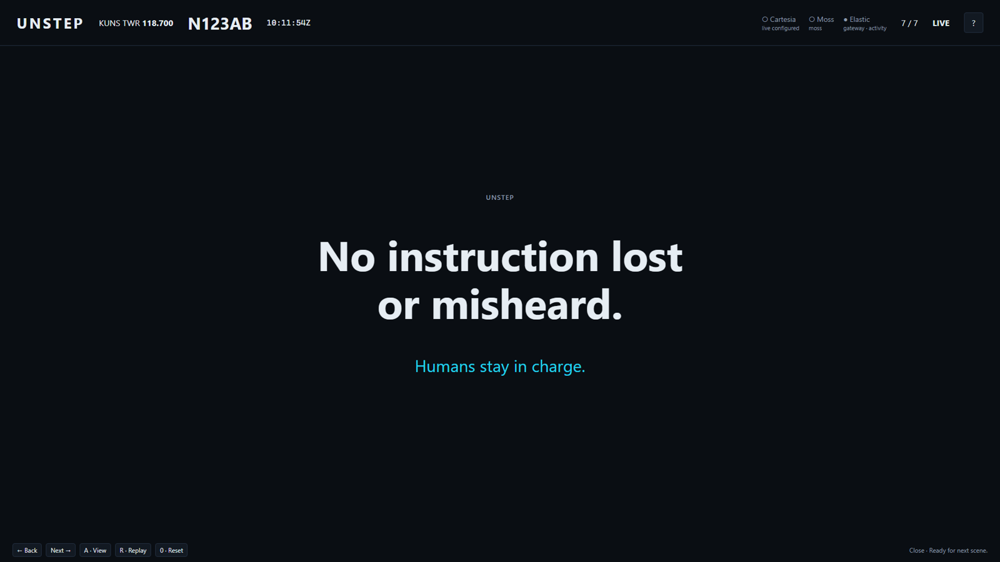

# Unstep

**No ATC instruction lost or misheard.** Unstep catches radio calls that were stepped on or read back wrong, has a human controller approve the correction, and speaks it into the pilot's headset with Cartesia voice.

Pilots and controllers share one half-duplex VHF channel, so when two stations transmit at once the call turns into a squeal and is lost. An FAA CAMI study (DOT/FAA/AM-05/19, 2005) found blocked, stepped-on or clipped calls in 1.16% of transmissions sampled at the five busiest US TRACONs, and no alerting system for stepped-on or clipped calls ([source](https://rosap.ntl.bts.gov/view/dot/58248/dot_58248_DS1.pdf)). Today recovery depends on someone noticing and asking "say again", and a misheard readback is only caught if the controller happens to hear it.



*Full view after a live run: the tower words lost under the squeal are struck out, Moss found the cockpit's local hint in 2 ms with its source record, the controller approved by voice (a recorded clip, labeled on screen), the wrong readback ("23") was caught and corrected, and Moss Inference answered the free-form question with an exact quote of the approved clearance. Every number in the bottom strip was measured in that run.*

## Presenter mode (the live demo)

```bash
python -m unstep.demo --live    # real Cartesia, Moss and Moss Inference; warms up for about 30 s
python -m unstep.demo           # same pipeline offline, with labeled fakes
python -m unstep.demo --live --mic   # the presenter speaks the controller and pilot lines live
```

Before presenting, `python scripts/preflight.py` checks keys, clips, Cartesia, Moss and Moss Inference and ends with READY. Opens `http://127.0.0.1:8765/demo/`. **Space** runs the next scene, **A** toggles audio mode and the full view, **?** shows the keys. Every scene runs the real pipeline on recorded clips in `assets/clips/real/`; nothing on screen is canned.

With `--mic` (needs `--live`), scenes 2 to 4 wait for the presenter instead of the clips: the screen shows "HOLD V TO TALK · as CONTROLLER" or "as PILOT" with what to say. Hold **V**, speak, release. The browser streams the microphone (16 kHz PCM16, echo cancellation and noise suppression on) to `/demo/mic`, Cartesia ink-2 transcribes it on the manual endpoint and finalizes on release, and the real pipeline handles whatever was said: the approval still needs a strict "Approve" with repeat-back, a wrong readback is still caught, unclear speech gets "Say again". If nobody speaks within 30 s the recorded clip runs instead, labeled as a mic fallback. Live lines are tagged LIVE MIC on screen and are not played back (R replays them). Design and storyboard: [docs/11-demo-design.md](docs/11-demo-design.md). Pitch script: [docs/12-pitch.md](docs/12-pitch.md).

| Audio mode (the first minute) | Close |
| --- | --- |
|  |  |

Full spec: [docs/01-prd.md](docs/01-prd.md). We logged API feedback for Cartesia: [docs/09-cartesia-feedback.md](docs/09-cartesia-feedback.md).

## Demo

```bash
python scripts/run_demo.py           # full flow, offline, no keys needed
python scripts/run_demo.py --clean   # a clean call: proves no false alarm fires
```

One command starts the gateway, mock ground agents, the controller voice approval loop and the real cockpit pipeline on `assets/clips/stepped_on_call.wav`, with fake STT and TTS. It prints what each party heard, with measured latencies:

1. The overlap detector finds the squeal on the stepped-on call.
2. Pilot hears a chime, then "Advisory. Transmission blocked. Likely hold short runway tree tree. Awaiting controller." The hint comes from local memory search, with its source record.
3. The controller hears "Blocked call to N123AB: hold short Runway 33. Approve?", says "Approve" on the Unstep key, hears the repeat-back, and only then is the directive sent (`unstep/ground/voice_approval.py`).
4. The directive plays in the left ear only, ending "Read back."
5. Pilot reads back "runway two three". Unstep: "Readback incorrect", pilot corrects, confirmed.
6. Pilot asks "Unstep, what was my last clearance?" and gets an answer from the flight session.

Audio is written to `data/cockpit_audio.wav`, events to `data/events.jsonl`.

**Live, with keys:** fill `.env` (below), then run the gateway and the real cockpit edge. With `CARTESIA_API_KEY` and `CARTESIA_VOICE_ID` set, the edge uses Cartesia STT and TTS; with `MOSS_*` set it uses Moss.

```bash
uvicorn unstep.gateway.server:app --port 8765               # gateway, dashboard at http://127.0.0.1:8765
python -m unstep.ground.mock_agents                          # ground agents (Elastic replaces this, task B5)
python -m unstep.cockpit.monitor --url ws://127.0.0.1:8765   # Frequency Monitor
python -m unstep.cockpit.edge assets/clips/stepped_on_call.wav --play
```

Approve by voice with `python -m unstep.ground.voice_approval` (add `--live --answer-clip <wav>` for Cartesia), or click Approve or Reject on the dashboard. `python -m unstep.ground.auto_approver` approves everything instantly for load tests. `python -m unstep.cockpit.mock_cockpit --runs 10` is a lightweight stand-in for the edge.

## Browser demo plumbing

Open `/demo/` on the gateway for a read-only message list. `/ws/observer` receives
all routed contracts, including audits and gateway decisions, and replays the
last 200 messages on reconnect. It uses the same token and origin checks as
other roles and rejects all incoming messages. Part B replaces the placeholder
page.

Add `--demo-audio-dir` to the edge, controller voice loop or `scripts/run_demo.py`
to save WAV artifacts under `data/demo/audio/`. An explicit directory is also
accepted; use the same directory in `create_app(demo_audio_dir=...)` when running
a custom gateway. The one-command demo passes it through automatically. Audio
export is off by default. The standalone gateway serves the default directory
at `/demo/audio/`. Files remain until manually removed.

Speech audits carry `party`, `spoken_text` or `heard_text`, available `words`
with seconds relative to the WAV (including the chime), and optional `audio_url`.
Controller utterances stream individually when demo audio is enabled; otherwise
they are included in the final controller audit's `utterances` list. Text-only
fake pilot/controller input has no recorded audio to export.

```bash
python -m unstep.ground.tower --clip assets/clips/real/clean_call.wav --live
python scripts/run_demo.py --live --demo-audio-dir
```

`TowerTranscriber.transcribe` accepts 16 kHz mono PCM16 bytes, PTT start/end epoch
milliseconds, frequency and callsign. It uses keyed ink-2 text and a second
ink-whisper stream for word timing. Both streams are paced and finalized at the
end of the PTT duration, using Cartesia's [manual STT endpoint](https://docs.cartesia.ai/api-reference/stt/websocket).
Without `--live`, the tower client uses the explicit scenario fake. Tower word
offsets remain seconds from `ptt_start`; pass a shared `--ptt-start` when matching
independently replayed tower and cockpit recordings. The demo runner supplies a
shared epoch automatically. The runner retains its scripted controller approval;
use the standalone voice approval client for recorded controller answers.

## Setup

```bash
python -m venv .venv && source .venv/bin/activate   # Windows: .venv\Scripts\activate
pip install -r requirements.txt
cp .env.example .env                                # fill in keys, never commit .env
```

| Key | Used for |
| --- | --- |
| `CARTESIA_API_KEY` | Cartesia TTS and STT |
| `CARTESIA_VOICE_ID` | The advisory voice |
| `CARTESIA_PRONUNCIATION_DICT_ID` | ATC pronunciation dictionary (from the upload script below) |
| `MOSS_PROJECT_ID`, `MOSS_PROJECT_KEY` | Moss indexes (local fallback without them) |
| `ELASTIC_CLOUD_URL`, `ELASTIC_API_KEY` | Elastic (planned, Dev B) |
| `UNSTEP_GATEWAY_URL` | Gateway address, default `ws://127.0.0.1:8765` |
| `UNSTEP_GATEWAY_TOKEN` | Optional shared secret; clients then connect with `?token=` |

Then, once per account:

```bash
python scripts/upload_pronunciation_dict.py   # uploads assets/pronunciation/atc.json, prints the id
python scripts/smoke_cartesia.py              # TTS first audio, STT round trip, turn events
python scripts/smoke_moss.py                  # seeds and queries Moss, prints search time
python scripts/make_real_clips.py             # optional: real-speech clips into assets/clips/real/
```

Every script prints `skipped: ...` and exits 0 when its keys are missing.

## Cartesia features used

| Feature | Where in code | Why |
| --- | --- | --- |
| Sonic TTS (`sonic-3.6`) over WebSocket, one context per message | `unstep/cockpit/tts.py` `CartesiaTTS` | Low-latency advisory voice. Measured **214 ms to first audio** on our laptop, including network (`smoke_cartesia.py`) |
| Word timestamps (`add_timestamps`) | `CartesiaTTS.speak` | Collected per word, for highlighting words as spoken (on-screen highlight is planned) |
| Pronunciation dictionary | `assets/pronunciation/atc.json`, `scripts/upload_pronunciation_dict.py`, `pronunciation_dict_id` in the request | ATC numbers and words: "niner", "tree", "fife", "Unstep" |
| Calm advisory voice (`emotion: calm`, speed 1.1, volume 1.2) plus chime and "Advisory" prefix | `AdvisoryVoice`, `advisory()`, `chime()` | Never mistaken for a controller (FR-8, FR-16) |
| Left-ear output | `to_left_stereo` | Directives stay off the radio ear (FR-7) |
| Context cancel on interrupt | `CartesiaTTS.cancel`, `AdvisoryVoice.interrupt` on `turn.start` | Pilot speech cuts the voice off (FR-10) |
| Ink-2 STT with key terms (callsigns, runways, "hold short", "niner") | `unstep/cockpit/stt.py` `build_keyterms`, `CartesiaManualSTT` | Correct ATC words. Verified live: "likely hold short runway tree tree" came back exactly |
| Manual `finalize` on squelch close / PTT release | `CartesiaManualSTT.finalize`, used by `unstep/cockpit/edge.py` when a key is set | Transcript is final the moment the transmission ends |
| Turns endpoint (`turn.start` / `turn.end`, tuned end threshold) | `CartesiaTurnSTT` | Readbacks and pilot queries. Client works live (`smoke_cartesia.py`); the edge uses a scripted fake by default. Also used for controller voice approval (`unstep/ground/voice_approval.py`, task B10) |
| `ink-whisper` for word timestamps | `unstep/ground/tower.py` | Second paced stream for tower word times and blocked-word marking |

## Moss and Elastic

| Sponsor | Built | Planned |
| --- | --- | --- |
| Moss | `unstep/cockpit/memory.py`: `airport-<ICAO>` and `flight-<callsign>` indexes, one writer per index, filter translation to Moss format, local fallback with the same interface. Local hint (`hint.py`) and pilot queries (`queries.py`) with search time shown. Frequency Monitor (`monitor.py`) owns `freq-<frequency>`. **Verified on real Moss** (hint 0.6 ms, query 1.0 ms). `airport-KUNS` is a persistent cloud index created once by `scripts/ingest_airport.py` and loaded at startup; flight and frequency data are sessions. **Moss Inference** answers free-form pilot questions from records we retrieve, validated as exact quotes (`unstep/cockpit/inference.py`, about 165 ms to first token warm) | |
| Elastic | Gateway writes every message to an event sink (`data/events.jsonl` today) | Elastic events index, Workflow with Agent Builder agents (Intercept, Compliance with FAA JO 7110.65 citation, Readback Auditor), ES\|QL audit (task B5) |

## Why stretched-thin towers need a safety net (context, not a result)

Unstep is not a way to run a tower with fewer controllers. It is a second set of ears for the controller who is already stretched thin. The figures below are from public sources; none are ours.

- **Towers run short.** A 2025 National Academies report found the FAA hired about two thirds of the controllers it projected for 2013 to 2023, and that 19 of its largest facilities have 15% fewer people than they need ([National Academies](https://www.nationalacademies.org/news/actions-from-federal-government-needed-to-alleviate-air-traffic-controller-staffing-shortages-at-many-facilities-says-new-report)). Trade coverage puts the shortfall of certified controllers at roughly 3,000 to 3,500 ([Flying](https://www.flyingmag.com/faa-unveils-atc-staffing-blueprint)). The FAA's own target has since been revised, so treat the exact number as moving ([AVweb](https://avweb.com/aviation-news/faa-lowers-controller-staffing-target/)).
- **New controllers take years.** A trainee at a large facility takes at least 4.8 years to certify, per the National Academies report as cited by [Aviation Safety News](https://www.globalair.com/articles/the-faas-real-atc-problem-how-certification-holds-the-key-to-hiring-woes/11696). Hires made now do not close the gap soon.
- **Short staffing means combined positions and overtime.** The NTSB found that at DCA on 29 January 2025 the tower had combined the helicopter and local control positions during a busy period, which increased workload and reduced situational awareness ([NTSB](https://www.ntsb.gov/news/Testimony/Pages/Homendy-20260212.aspx)). The NTSB also found flawed airspace design and recommended a review of staffing at DCA; the combined positions were one contributing factor among several.
- **Rest rules are tight.** In 2024 the FAA raised minimum rest between shifts from 9 to 10 hours and required 12 hours before an overnight shift ([NPR](https://www.npr.org/2024/04/22/1246349237/close-calls-faa-air-traffic-control-fatigue)). The controllers' union warned that this can open coverage gaps filled with overtime, which adds fatigue ([Safety+Health](https://safetyandhealthmagazine.com/articles/25826-after-a-delay-faa-finalizes-air-traffic-controller-rest-policy)).

**What Unstep does about it.** It takes the routine checking load off a controller who is working short-staffed or combined positions: checking each readback against the clearance, finding the rule, drafting the fix. The controller decides every time, can see why, and can switch the agents off. The aim is that nothing slips through when someone is overloaded. It does not replace a position or reduce staffing.

**What we have measured:** call end to the pilot hearing a fix, and how many calls a rule check handles without a person (see `docs/18-benchmark.md`; the benchmark traffic is simulated and labelled so).

**What we have not measured:** whether this reduces missed calls or controller workload in a real facility. We have not tested it in one. Do not quote a safety or staffing effect from this project.

## Responsible use

- **A human authored or approved every directive.** The policy agent may auto-resend a blocked call only when it repeats the controller's own transmitted words, is a stop/wait instruction, is fresh and high confidence; the gateway re-checks it. Every auto-resend appears on the ATC console with its checks, one switch turns auto-resend off, and everything else (anything that lets a plane move) waits for the controller's Approve.
- **Restrictive-only hints, with sources.** Before approval the pilot only hears a "Likely" hint for instructions that make the aircraft stop or wait (hold short, go around). Permissive instructions (cleared for takeoff, cross runway) are never hinted. No source record, no hint.
- **Only the Unstep key commands Unstep.** Speech on the radio frequency is transcribed but never obeyed.
- **Never mistaken for ATC.** Every message starts with a chime and "Advisory", in a distinct synthetic voice. No voice cloning of controllers.
- **Privacy.** Tower audio is transcribed only to recover blocked or misheard instructions. In the prototype all data stays local in `data/`. No keys in the repo: `.env` is ignored and the gateway accepts an optional token.
- **Accessibility.** Readback checks help pilots under high workload or with hearing difficulty. Blocked words are highlighted on the dashboard; highlighting words as they are spoken uses Cartesia word timestamps (screen side planned).

## Known limitations

- **Overlap detection is narrow.** It finds the heterodyne beat tone, not a second voice, and is only proven on clips we mixed ourselves. A full overlap, where the stronger signal captures the receiver, can't be detected from audio at all ([research RA-4](docs/06-research.md#3-evidence-table)). The reliable signal is comparing tower and cockpit transcripts.
- **Simulator, not avionics.** A laptop stands in for the audio panel. Nothing here is certified.
- **Moss real backend untested end to end.** Filters are translated to Moss's format and covered by tests, but the full demo has only run on the local fallback.
- **Cartesia workarounds.** `ink-2` returns no word timestamps and `ink-whisper` has no key terms (Cartesia feedback item 2), so tower word times need a second stream. The turns endpoint returns empty transcripts if audio arrives faster than real time (Cartesia feedback item 1), so replays are paced at real time.
- **Readback parser is regex-based.** It compares callsign, action and runway only; unusual phrasing can be misread.
- Ground agents and Elastic are mocked today (task B5). Controller voice approval is built and tested with scripted speech; live mode replays a recorded answer clip, there is no live microphone input yet.

## Repo layout

| Path | What | Owner |
| --- | --- | --- |
| `unstep/contracts.py` | Shared message contracts | Both |
| `unstep/clock.py` | One clock, epoch ms (FR-17) | Both |
| `unstep/scenario.py` | Demo scenario data | Both |
| `unstep/cockpit/` | Cockpit edge: overlap detector, Cartesia STT/TTS, Moss memory, hint, readback, queries, Frequency Monitor | Dev A |
| `unstep/gateway/` | WebSocket gateway and event sink | Dev B |
| `unstep/ground/` | Controller voice approval (B10), mock agents, auto approver | Dev A built B10, Dev B owns the rest |
| `web/dashboard.html` | Controller dashboard | Dev B |
| `scripts/` | Demo, smoke tests, clip generation, pronunciation upload | Both |
| `assets/` | Demo clips and pronunciation dictionary | Dev A |
| `contracts/examples/` | One JSON example per contract (`python scripts/export_contract_examples.py`) | Both |
| `docs/` | PRD, architecture, research, Cartesia feedback | Both |

Every message is an envelope `{"type": "AnomalyEvent", "ts": 1792800000000, "data": {...}}` on `ws://<gateway>/ws/<role>`, role one of `cockpit`, `tower`, `agents`, `dashboard`, `controller_voice`, `monitor`, `observer`. Routing is in `unstep/gateway/server.py` (`ROUTES`).

## Tests

```bash
python -m pytest -q   # 129 passed, 1 skipped, offline
```

## Control Tower console

Run `python -m unstep.live` and open `/live/atc/` on the server (normally `http://127.0.0.1:8765/live/atc/`). Open `/live/` on the phones to pick Plane A or Plane B. Use the server's LAN or HTTPS tunnel address on phones. The projector-only link retains the existing read-only observer seat.

**Laptop as the tower, phones as planes:** start with `python -m unstep.live --host 0.0.0.0`, add the laptop's LAN IP to `UNSTEP_ALLOWED_HOSTS` in `.env` (the gateway only answers local hosts otherwise), open `http://<LAN IP>:8765/live/atc/` on the laptop, and scan the QR code in its header with each phone. Phone microphones need HTTPS; without it, phones use the "say" buttons, which still go on the radio for real.

Set `UNSTEP_ATC_PASSWORD` in your shell or local `.env` before starting the room. Choose Control Tower in the seat picker and enter it. The server verifies the password before joining the tower socket; plane and observer seats do not need it. If unset, tower access is open and the console says **ATC password not set**. The existing gateway token and origin checks still apply. Passwords travel in the first WebSocket frame, not in URLs; use HTTPS when sharing across a network.

Click **Turn on sound** once to hear the radio and controller prompts. Type a tower instruction or use the two suggested transmissions. Approve or reject escalated proposals in the decision inbox; the auto-resend switch controls only verified stop/wait instructions. The map is illustrative, not live aircraft tracking. Status, lost words, policy reasons and readbacks come from received room messages. Unreported timings say **not measured**; offline speech and ground stand-ins are labeled. QR generation remains a TODO; the header displays the join address instead.
