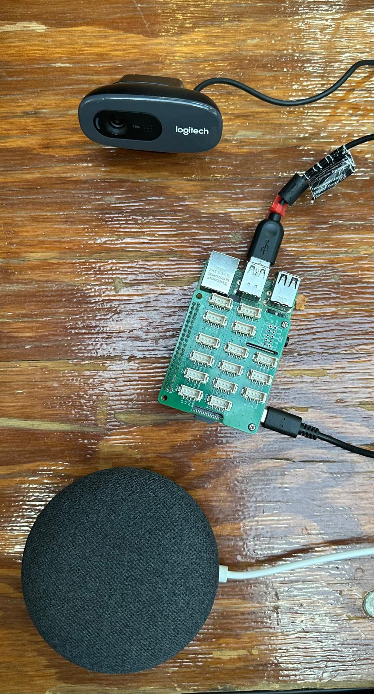

# Unstep

**Agentic air traffic control. A second set of ears for every controller.**

Unstep is a team of AI agents that works the radio *with* an air traffic controller. It listens to every transmission, catches calls that were stepped on, checks every readback, drafts the next clearance, speaks privately to the one pilot who needs it, and records every decision. **The controller approves everything; the agents never act alone.**

Built at Cal Hacks 13.0 with **Cartesia** (the ears and the voice), **Moss** (each aircraft's memory) and **Elastic** (the agent platform). Every number in this README was measured in our own runs. Where something is built but not yet measured live, we say so.

| | |
| --- | --- |
| Demo video | 2:58, linked from the Devpost submission; its source is in [`video/`](video/) (Remotion) |
| Try it | Scan the QR code on the ATC console and your phone becomes a plane ([Setup](#setup)) |
| Tracks | Cartesia · Moss · Elastic (Best use of the Elastic Agent Builder on a Serverless instance) |

---

## Contents

1. [The problem](#1-the-problem)
2. [What Unstep does](#2-what-unstep-does)
3. [One complete flow (the demo)](#3-one-complete-flow-the-demo)
4. [How it works](#4-how-it-works)
5. [**Cartesia**: the ears and the voice](#5-cartesia-the-ears-and-the-voice)
6. [**Moss**: each aircraft's memory](#6-moss-each-aircrafts-memory)
7. [**Elastic**: the agent platform](#7-elastic-the-agent-platform)
8. [The two screens](#8-the-two-screens)
9. [Evidence and how to re-run it](#9-evidence-and-how-to-re-run-it)
10. [Impact and responsible use](#10-impact-and-responsible-use)
11. [Setup](#setup)
12. [Testing](#12-testing)
13. [Known limitations](#13-known-limitations)
14. [Repo layout](#14-repo-layout)
15. [How we built it, and credits](#15-how-we-built-it-and-credits)

Also: [What it looks like](#what-it-looks-like) · [Built in a day](#built-in-a-day)

---

## 1. The problem

Every flight is guided by a voice on the radio: an air traffic controller. The FAA handles about **45,000 flights a day**, and the people doing it are stretched thin:

- **Short-staffed.** The FAA is about **3,500 controllers short** of its own goal, "with many already on mandatory overtime and six-day weeks" ([Washington Examiner, Oct 2025](https://www.youtube.com/watch?v=n0zGNlVS0J8)).
- **At the busiest airports.** Washington Reagan National runs on **20 certified controllers where it should have 30** (NATCA via [FOX 5 DC](https://www.fox5dc.com/news/dca-air-traffic-controllers-working-six-day-weeks-due-staffing-gap)). The radar facility that guides Newark had **24 of 38** positions filled (FAA via [Fox Business](https://www.foxbusiness.com/politics/air-traffic-controllers-take-trauma-leave-after-close-calls-communication-failures-newark)).
- **For years.** The union describes controllers working "six days a week, 10 hours a day, for years at a time" ([CNN, Mar 2025](https://edition.cnn.com/2025/03/08/us/air-traffic-controllers-us-shortage)).
- **One person, two jobs.** At DCA on 29 January 2025, the tower had combined the helicopter and local positions. The NTSB found that raised workload ([NTSB](https://www.ntsb.gov/news/Testimony/Pages/Homendy-20260212.aspx)). Transportation Secretary Sean Duffy, on ABC: *"There is a level of risk that gets injected into the system when we have a controller that's doing two jobs instead of one."*

Pilots and controllers share **one half-duplex radio channel**: only one voice gets through at a time. When two people transmit at once, everyone else hears a squeal, and **neither speaker knows**. An FAA study found blocked, stepped-on or clipped calls in **1.16%** of transmissions at the five busiest US approach facilities, and "no alerting system was detected" for them ([FAA CAMI, DOT/FAA/AM-05/19](https://rosap.ntl.bts.gov/view/dot/58248/dot_58248_DS1.pdf)). At the NTSB hearing on the 2025 DCA midair, the tower operations manager was asked whether a controller can tell that a call was stepped on. His answer: **"There's nothing."** ([AIN](https://backend.ainonline.com/aviation-news/air-transport/2025-08-04/ntsb-dc-midair-hearing-panel-3-covers-frequency-issues))

An overloaded controller can't catch every missed word and every wrong readback alone. **Unstep is not a way to run a tower with fewer people.** It is the help the people already there don't have.

## 2. What Unstep does

| Job | What it does | Powered by |
| --- | --- | --- |
| **01 Listens** | Turns every transmission, tower and cockpit, into live text while people talk | **Cartesia** Ink-2 |
| **02 Catches** | Detects a call that was stepped on and recovers the words that were lost | **Moss** + **Cartesia** + our overlap detector |
| **03 Checks** | Compares every readback with the instruction; a wrong runway is flagged and **the aircraft does not move** until it's right | **Cartesia** Ink-2 + **Elastic** percolator rules |
| **04 Drafts** | Proposes the next clearance from the flight plan, the aircraft's last call and live runway occupancy, even before anyone asks | **Elastic** Agent Builder + `geo_shape` + **Moss** |
| **05 Speaks** | Speaks the recovered instruction privately to the one pilot who missed it, in the left ear, in their language | **Cartesia** Sonic |
| **06 Records** | Logs every decision for audit, answers questions about the shift, writes the shift briefing and a nightly review | **Elastic** (ES\|QL, Workflows, Agent Builder) |

**The controller approves everything.** Agents propose, cite and check. They never write an instruction and never grant permission. The only automatic action (re-sending the controller's own stop/wait words after a stepped-on call) has visible policy checks and an off switch, and is off in the demo.

## 3. One complete flow (the demo)

The laptop is the control tower on the projector. Phones are the planes: **scan the QR on the console and you're a pilot.** This is the flow in the demo video, recorded live on the real system (`scripts/capture_demo_footage.py`):

1. **Plane A asks for taxi.** The **Clearance agent** proposes *"Cessna 1-2-3, taxi to runway 33 via Bravo, hold short of runway 33"*:
   - the flight plan comes from **Elastic** (`unstep-flightplans`);
   - the aircraft's last tower call comes from its **Moss** session in under 1 ms;
   - "runway clear" comes from an **Elastic** `geo_shape` query.
   The controller taps **Send**, and **Cartesia** Sonic speaks it on the frequency.
2. **The pilot reads it back; only then does the aircraft move** (FAA JO 7110.65 ¶2-4-3, AIM 4-3). It taxis on the 3D airport and stops at the hold-short line.
3. **The tower says "Cessna 1-2-3, hold short runway 33", and at the same moment the helicopter keys up.** The Cessna's receiver carries two voices.
4. **Unstep catches it.**
   - The overlap detector flags the squeal; **Cartesia** Ink-2 shows what the cockpit actually heard.
   - **Moss** searches the Cessna's own memory with that garbled fragment and recovers "hold short runway 33".
   - **Elastic** matches the instruction to its FAA rule: ¶3-7-2, hold short is restrictive and must be read back.
   - A decision card appears: *"Plane A missed 'Cessna 1-2-3, hold short Runway 33'. Approve?"*
5. **The controller approves with one tap.**
6. **Only the Cessna hears it.** **Cartesia** Sonic speaks *"From Tower: Cessna one two three, hold short runway three three. Read back."* into the pilot's left ear, labelled "Only you · left ear" on the phone. The helicopter is told separately that its call was blocked.
7. **The pilot reads back; Unstep checks it:** *"Read back correct."*
8. **A new clearance, a wrong readback.** The pilot reads back "runway **13**". Unstep flags it, and the aircraft stays put. Corrected, it lines up.
9. **The agent proposes the next step unasked.** Lined up, runway clear: *"Cessna 1-2-3, runway 33, cleared for takeoff."* Sent, read back, airborne.

### What it looks like

All screenshots below are from our offline demo build (fake speech, so no API calls). The flow, the agents and the screens are the real code; the speech and timing numbers are in section 9.

#### The tower console


The controller's screen. The 3D airport shows every plane. The **QR code** (bottom left) is the one way in: a judge or customer scans it and their phone becomes a plane. The panel on the right is "Agents at work".

#### A call gets stepped on


The tower and Plane A talked at the same time, so both lanes at the bottom say **TALKED OVER**. The headline says what happened in plain English. The card on the right is the part that needs a person: **Approve and send** or **Reject**. Below it, the agents list what they did: the Elastic geo lookup (where the plane was), the Cartesia recovery agent (told Plane A its call was blocked), the policy agent (asked the controller to decide), the ground agents (drafted the fix) and the cockpit agent.

#### The team of agents


One person, one fixed workflow, five agents. The orchestrator is an Elastic Workflow with written-down steps: it sequences the agents and decides nothing. Only the controller approves anything that moves a plane.

#### A phone is a plane

| Join | In the air |
| --- | --- |
|  |  |

Scan the QR, tap once, hold the big button to talk. The card says what to say, so a judge who has never heard a radio call can do it.

#### A Raspberry Pi is a plane too



The hardware: a Raspberry Pi 4 (with a Grove Base HAT), a Logitech webcam used as the microphone, and a Google Nest Mini. The Pi joins the same room as a pilot (`scripts/pi_plane.py`). Only the Pi's microphone and network are in use today: the Nest Mini is not connected as a speaker yet, and the plane's decisions still run on the hub.


The level bar shows the microphone is on and working, and the tool warns when the signal is too loud. This capture is from before the client began setting the microphone level itself, which is why it reports clipping.

---

## 4. How it works

```mermaid
flowchart LR
  subgraph Radio["Radio · 118.700 (one shared channel)"]
    TWR[Tower mic]; A[Cessna radio]; H[Helicopter radio]
  end
  subgraph Cockpit["In each cockpit (on board)"]
    OD[Overlap detector] --> INKC[Cartesia Ink-2<br/>what the cockpit heard]
    INKC --> MOSS[(Moss session<br/>this aircraft's clearances)]
    MOSS --> REC[Recovered instruction]
  end
  subgraph Ground["Ground · ATC hub"]
    INKT[Cartesia Ink-2<br/>tower transcript, key terms] --> RULES[(Elastic percolator<br/>FAA JO 7110.65)]
    RULES --> WF{{Elastic Workflow<br/>Intercept ‖ Compliance agents}}
    REC --> WF
    WF --> CTRL[Controller approves]
    CTRL --> AUD[(Elastic audit · ES|QL · Kibana · MCP)]
    CLR[Clearance agent<br/>flight plan · geo_shape · Moss] -.-> CTRL
  end
  subgraph Back["Back to the cockpit"]
    SONIC[Cartesia Sonic<br/>private, left ear] --> RB[Pilot readback] --> CHK[Ink-2 + readback check] --> MOVE[Aircraft may move]
  end
  A --> OD; TWR --> INKT; H -.-> OD
  CTRL --> SONIC
  MOSS -. flight log on landing .-> MCLOUD[(Moss Cloud)]
```

**There is no "boss" agent.** Fixed code decides what a sentence is (an ordinary call, a stepped-on call, a readback, a question), and only the agents that event needs are called. The same sentence always takes the same path. A sentence reaches zero to two agents. ([docs/20-agent-map.md](docs/20-agent-map.md))

**Measured end to end (live):** from the end of a stepped-on call to the pilot hearing the fix, **2.9 s**, with the controller's approval included.

## 5. Cartesia: the ears and the voice

Real-time voice AI: Sonic turns text into speech and Ink turns speech into text ([Cartesia changelog](https://docs.cartesia.ai/changelog/2026)). On a radio everything is voice, and a wrong word is a wrong runway.

| Feature | What it does in Unstep | Measured |
| --- | --- | --- |
| **Ink-2 streaming speech-to-text** | Transcribes the tower and every cockpit while they talk | final words 141 ms after release (median; 95th percentile 298 ms, n=30) |
| **Key-term prompting** | 29 aviation terms per cockpit, 39 for the tower: callsigns, runways, taxiways, "niner", "hold short" | heavy noise: callsigns 61.5% to 93.5%, runways 78.7% to 99.3% (200 lines, 136 with a runway) |
| **Sonic text-to-speech** | Speaks the recovered call to one pilot, left ear only | first audio 92.9 ms median, 207 ms at the 95th percentile (n=30) |
| **Same voice, other languages** | The advisory repeated in Spanish, Hindi or French | checked live |
| **Pronunciation dictionary and speed** | ATC words said the ATC way; corrections spoken slower | 0.85x for corrections (a setting) |
| **Live captions and interruption** | Captions on every screen; the advisory stops when the pilot keys the mic | final caption 154 ms after release (median of 5 runs, worst 215 ms); while speaking, a caption update about every 0.8 s |

*Evidence:* `docs/evidence/cartesia-*.json` (the raw results of `scripts/eval_bench.py`, `scripts/cartesia_repro.py` and `scripts/cartesia_live_check.py`, summed up by `scripts/evidence_cartesia.py`). Streaming the audio while the key is held finalizes in 141.25 ms (median), against 876.25 ms when the whole clip is sent at once; that is why the room streams. Of the three voices the pilot's is the hardest (callsign 80.6% with key terms). The 200 test lines are synthetic Cartesia voices sent through our simulated VHF radio channel at several noise levels, so these numbers compare with and without key terms on the same audio; they are not an accuracy figure for real controllers. Sonic's cloud API is what we use; Cartesia's on-device Sonic is in private beta and we are not on it.

**The loop caught our own mistake.** We had respelled "niner" as "NY-ner" in the pronunciation dictionary; Sonic then said something Ink-2 heard as "N1er", and runway accuracy was 85%. Speaking the dictionary back through speech-to-text found it, and the fix took it to 100%.

---

## 6. Moss: each aircraft's memory

Real-time semantic search that runs inside an agent's own process ([Moss for voice agents](https://www.moss.dev/use-cases/voice-agents)). Each cockpit agent's loop is Cartesia Ink hears, Moss searches the plane's memory, Cartesia Sonic speaks.

| Feature | What it does in Unstep | Measured |
| --- | --- | --- |
| **One in-process session per aircraft** | Every clearance and call a plane hears is indexed in its own memory, on board | 6 sessions, reads 0.358 ms median, 0.619 ms at the 95th percentile (n=300) |
| **Hybrid search** | The scrap the pilot did hear finds the full instruction, by meaning and by exact words | right clearance 1.0, a weaker fragment 0.87, unrelated speech 0.0 |
| **Metadata filters and sorting** | Only this aircraft, only tower calls, newest first: the Clearance agent's "last call" | 0.358 ms median (the same 300 reads as the first row) |
| **Ask your memory, by voice** | "What was my last clearance?" answered from Moss and spoken by Sonic | Moss's part 0.301 ms median, 0.64 ms at the 95th percentile (n=25); our wall clock around a text query is about 5 ms |
| **Save to disk and load on restart** | The memory survives a restart without downloading anything | 4 documents restored in 9.9 ms; a whole restart to the first answer takes 1.8 s, because opening a session contacts Moss |
| **Moss Cloud sync** | Each finished flight's log is pushed to the cloud once | survives a restart: a fresh client read 2 documents back in 1.7 s (the index builds in 2.2 s) |

*Evidence:* `docs/evidence/moss-*.json` (written by `scripts/evidence_moss.py`: real Moss, six sessions, the sample counts shown) and `docs/evidence/moss-live-check-*.txt` (the output of `scripts/moss_live_check.py`, which also proves the disk restore and the cloud sync). The speed figures are the milliseconds Moss itself reports. A hint only ever says stop or wait, only with a source record, and an older clearance never comes back ahead of a newer one.

---

## 7. Elastic: the agent platform

Search, ES|QL, Agent Builder and Workflows on one Serverless project, deployed from code with `python scripts/deploy_elastic.py` ([Agent Builder](https://www.elastic.co/elasticsearch/agent-builder)). Each agent can only call its own fixed queries, and no agent writes to the audit trail.

| Feature | What it does in Unstep | Measured |
| --- | --- | --- |
| **Agent Builder** | 8 agents: Intercept, Compliance, Ground, Readback Auditor, Audit, Coach and two fast variants | 8 agents and 9 tools counted on our project |
| **Workflows** | Agents run in parallel on every stepped-on call; a shift briefing every 8 hours; a nightly review | 7 workflows on the project, event-driven and scheduled (run by hand; the clock firing is not yet observed) |
| **Percolator rules** | Each instruction and readback is matched to its FAA rule (JO 7110.65, the controller's rulebook) | Elastic's own time 1.0 ms; about 88 ms round trip from our laptop; 7 stored rules, one reviewed by a person |
| **Hybrid search and Jina rerank** | Finds the exact FAA paragraph to cite on every decision card | 0.89 s median, 1 s at the 95th percentile, reranked 30 of 30 (n=30), over 52 paragraphs |
| **geo_shape, flight plans and the airport map** | "Is the runway clear?" from live positions; the Clearance agent's plan; incursions flagged | Elastic's own time 0 ms, 85 ms round trip (n=30); 7,770 positions, 5 areas, 2 flight plans stored |
| **ES\|QL and MCP** | Safety analytics and the audit trail, asked in plain English; our tools exposed over MCP | 1,493 events from 6 planes stored; ES\|QL answers in 89 ms round trip; 9 of our tools exposed over MCP |

*Evidence:* `docs/evidence/elastic-*.json` (written by `scripts/evidence_elastic.py`: it counts the agents, tools and workflows from Kibana itself, then times the calls) and `docs/evidence/elastic-percolator-*.txt` (`scripts/rule_latency.py --elastic`). "Elastic's own time" is the server's `took`; the round trip adds the network from our laptop. At 7 rules a plain in-memory scan is faster than Elastic; the reason for percolating is that rules are data an editor changes without a deploy. An Agent Builder call takes about 5 to 10 s whatever the answer, so the agents stay off the pilot's critical path: the decision card goes out first and the citation is added when it arrives. The hold-short rule (paragraph 3-7-2) was reviewed by a person; the other stored rules are marked candidate or needs review.

---

## 8. The two screens

**ATC console** (`/live/atc/`, [`web/live/atc/`](web/live/atc/)), for the controller:
- **A 3D digital twin of the airport** (three.js): runway 33/15, taxiways A and B, connectors A1–A4, B1, B2, hold-short lines, terminal and parked aircraft. Planes queue on taxiway B, taxi along real routes, line up at the runway end, and take off.
- **Readback-first movement:** an instruction alone moves nothing; the aircraft moves only after a correct readback. "Hold position" acts at once.
- **"Agents at work" feed:**
  - green rows for what the agents did, amber for what needs a decision, red for what's wrong;
  - each row names the agent and the sponsor technology behind it;
  - **decision cards** for stepped-on calls and **Clearance agent cards**, each with what the agent checked and why.
- **Radio panel** with live captions per station and "TALKED OVER" marks.
- **Ask tab:** ask the audit agent about the last hour, or the coach about 30-day trends, with the ES\|QL shown. **Shift briefing** and **Nightly review** buttons.
- **Safety tab:** ES\|QL analytics. **"Show how":** the step-by-step evidence for an event, with a timing waterfall.
- **QR card** for walk-up pilots, a **Reset room** button, an auto-resend switch (off by default) and an optional tower password.

**Pilot app** (`/pilot/`, [`app/`](app/), React), the pilot's EFB:
- **Hold to talk** on the shared frequency.
- A **"Read it back" guide** that says what to say and whether the readback was right.
- **Live captions**, private advisories marked **"Only you · left ear"**, and a language choice.
- **Rejoins the same aircraft** after the phone sleeps.

## 9. Evidence and how to re-run it

Every number in the three tables above is read from a file in [`docs/evidence/`](docs/evidence/) by `python scripts/readme_tables.py`, so the README cannot say something the data does not. To re-measure:

```
python scripts/eval_bench.py --live --n 200 --conditions clean,radio-10 --stepped 0   # Cartesia key terms (uses credits)
python scripts/cartesia_repro.py --runs 30 --only manual_pacing                        # streaming against burst finalize
python scripts/cartesia_live_check.py --only tts caption --tts-runs 30 --runs 5        # Sonic first audio, caption timing
python scripts/evidence_cartesia.py                                                    # summarise the three Cartesia runs
python scripts/evidence_moss.py                                                       # six Moss sessions
python scripts/moss_live_check.py                                                     # disk restore and cloud sync
python scripts/evidence_elastic.py                                                    # agents, tools, workflows, citation, geo, audit
python scripts/rule_latency.py --elastic                                              # percolator
python scripts/readme_tables.py                                                       # rewrite the tables from the files
```

All of it ran on one laptop against our own cloud projects. Speech is synthetic, sent through a simulated radio channel. Simulated traffic is always labelled as such.

### Built in a day

First commit: **2026-10-23 21:00 PDT**.

| What landed | When (PDT) | Hours after the first commit |
| --- | --- | --- |
| Airport index script (Moss reference data) | 2026-10-24 00:12 | 3.2 |
| Elastic deploy script (agents, tools, workflows) | 2026-10-24 20:36 | 23.6 |
| FAA rulebook ingest (52 JO 7110.65 paragraphs) | 2026-10-24 21:07 | 24.1 |
| Traffic simulator (500 labelled calls, simulated) | 2026-10-24 23:15 | 26.3 |

---

## 10. Impact and responsible use

- **A person decides.** Every instruction that lets an aircraft move waits for the controller's approval. The only automatic re-send is the controller's own stop/wait words, with visible checks and an off switch.
- **Hints only ever say stop or wait,** and only with a source record. Permissive instructions are never hinted.
- **Agents never write an instruction.** The words come from the controller's own transmission. Agents cite, check and flag; they can only lower confidence.
- **Never mistaken for ATC.** Every advisory starts with "Advisory", in a distinct synthetic voice, in the left ear. We don't clone controllers' voices.
- **Only the Unstep key commands Unstep.** Speech on the frequency is transcribed but never obeyed.
- **Privacy.** Each advisory goes only to the pilot who missed the call. Aircraft memories stay on board. Keys stay in `.env` (never committed); the hub supports a room token and a tower password.
- **Accessibility.** Live captions on every screen; advisories in the pilot's language; a readback guide that shows what to say; readback checks help pilots under high workload.
- **What we do not claim.** We haven't tested this in a real facility. We don't claim any effect on staffing, workload or incidents.

## Setup

### Requirements

Python 3.12, Node 22, and optionally FFmpeg. Keys for Cartesia, Moss and Elastic are needed for the live system; **everything also runs offline with labelled fakes**.

```bash
python -m venv .venv && source .venv/bin/activate   # Windows: .venv\Scripts\activate
pip install -r requirements.txt
cd app && npm install && npm run build && cd ..      # the pilot app the hub serves at /pilot/
cp .env.example .env                                 # fill in keys; never commit .env
```

| Key | Used for |
| --- | --- |
| `CARTESIA_API_KEY`, `CARTESIA_VOICE_ID` | Ink-2, ink-whisper and Sonic |
| `CARTESIA_PRONUNCIATION_DICT_ID` | The ATC pronunciation dictionary (from `scripts/upload_pronunciation_dict.py`) |
| `MOSS_PROJECT_ID`, `MOSS_PROJECT_KEY` | Moss sessions, Moss Cloud, Moss Inference (local fallback without them) |
| `ELASTIC_CLOUD_URL`, `ELASTIC_API_KEY`, `KIBANA_URL` | Elastic Serverless project and its Kibana |
| `UNSTEP_ELASTIC_AGENTS=1` | Call the Agent Builder agents (otherwise local stand-ins) |
| `UNSTEP_ATC_PASSWORD` | Optional tower password |

### Run it

```bash
python -m unstep.live --offline        # no keys: fake speech, local memory and rules
python -m unstep.live                  # live: Cartesia, Moss and Elastic
```

- **Tower:** open `http://127.0.0.1:8765/live/atc/`.
- **Plane:** open `http://127.0.0.1:8765/pilot/` in a phone-sized window.
- **Phones over the internet, one scan:** run `python scripts/demo_public.py`. It starts a Cloudflare quick tunnel with a real HTTPS certificate, sets the hub's public address, and puts the QR code on the console. Phone microphones need HTTPS, which the tunnel provides.

### One-time setup per account

```bash
python scripts/upload_pronunciation_dict.py      # Cartesia: uploads assets/pronunciation/atc.json, prints the id
python scripts/ingest_faa.py --source data/faa   # Elastic: FAA JO 7110.65 paragraphs into unstep-faa
python scripts/deploy_elastic.py                 # Elastic: indexes, tools, agents, workflows (--replace to update)
python scripts/deploy_elastic.py --only maps     # Elastic: the Kibana map
python scripts/ingest_airport.py                 # Moss: the airport-KUNS cloud index
```

### Check each sponsor live

```bash
python scripts/cartesia_live_check.py    # caption cadence, turns pacing, TTS first audio, dictionary round trip, 429 handling
python scripts/eval_bench.py --live      # the 200-transmission radio-noise benchmark
python scripts/moss_live_check.py        # fragment search, flight log survives restart, restore from disk
python scripts/mcp_demo.py               # Elastic Agent Builder tools over MCP
python scripts/verify_wired.py           # the wired pieces, end to end
```

## 12. Testing

```bash
python -m pytest -q          # Python: hub, agents, rules, geo, Moss, Cartesia clients, console logic (offline, with fakes)
cd app && npx vitest run     # pilot app
python scripts/e2e_taxi.py   # live end-to-end: needs a hub on port 8796
```

Latest run: **596 Python tests** (1 skipped) and **31 pilot-app tests** passing. The live end-to-end suite passes **28/28**. It covers:
- queueing;
- both runway ends;
- a wrong readback held;
- taxi via Alpha;
- hold position;
- the Clearance agent with Elastic flight plans and the geo runway check;
- the unasked takeoff proposal.

## 13. Known limitations

- **Overlap detection is narrow.** It finds the heterodyne squeal, not a second voice. A full overlap, where the stronger signal captures the receiver, can't be detected from audio alone. Comparing tower and cockpit transcripts is the reliable signal.
- **Readback false alarms in noise.** In heavy noise, 25% of correct readbacks were flagged as wrong. That's the safe direction (an extra correction), but worse than the published HAAWAII lab figure of 11%.
- **Sonic speaks slower than a controller:** about 3.5 syllables per second against a median 6.1 (Nitta, Okazaki and Klinger 2011). A 13-syllable clearance takes about 3.7 s instead of 2.1 s. First audio is fast; the phrase is long.
- **Cartesia gaps we worked around:**
  - Ink-2 has no word timestamps, so tower word times need a second ink-whisper stream.
  - ink-whisper has no key terms.
  - A slow finalize tail and some hung handshakes were seen once, late at night, and not reproduced at midday.
  - About 2 in 25 turns runs ended with an empty `turn.end`; we retry once.
  - Details: [docs/24-cartesia-findings.md](docs/24-cartesia-findings.md).
- **Agent Builder latency.** The agents take about 10–11.5 s per call, so their citation arrives after the card. Nothing on the pilot's path waits for them, except one case: a restrictive, high-confidence proposal that policy might auto-relay waits so Intercept can veto it.
- **One API key for all agents.** Separation is by tool, not by per-agent permission.
- **The airport is a demo map, not a survey.** Positions are scene coordinates mapped onto real latitude and longitude.
- **Readback parser is rule-based.** It compares callsign, action, runway and taxiway; unusual phrasing can be misread.
- **Moss free plan:** three indexes per project, so old test indexes have to be deleted.
- **Simulator, not avionics.** Phones and a laptop stand in for radios. Nothing here is certified, and it has not been tested in a real facility.

## 14. Repo layout

| Path | What |
| --- | --- |
| [`unstep/live/`](unstep/live/) | The live hub (FastAPI, WebSockets): the room, routing, geo, flight plans, QR join |
| [`unstep/cockpit/`](unstep/cockpit/) | Cockpit agent: overlap detector, Cartesia STT/TTS, Moss memory, hints, readbacks, translation |
| [`unstep/ground/`](unstep/ground/) | Ground agents: Elastic agents client, rules (percolator), FAA citation, reports, audit chat |
| [`unstep/gateway/`](unstep/gateway/) | WebSocket gateway, routing, policy, event sink |
| [`web/live/atc/`](web/live/atc/) | ATC console: 3D airport, taxi routing, instruction parser, Clearance agent rules, feed |
| [`app/`](app/) | Pilot app (React) |
| [`elastic/`](elastic/) | Agent Builder agents, tools, workflows, rules, Kibana map |
| [`scripts/`](scripts/) | Deploys, live checks, benchmarks, end-to-end suite, demo capture |
| [`video/`](video/) | The demo film (Remotion) |
| [`docs/`](docs/) | PRD, architecture, research, benchmarks, sponsor notes, Cartesia feedback |
| [`tests/`](tests/) | Python tests |

## 15. How we built it, and credits

Two people, Rishit and Deekshith, each working with a coding agent:
- **Split:** one side built the controller console, the other the pilot app and the hub.
- **Coordination:** the two agents agreed every change by Markdown "mail" on a Git branch (`agent-mail`), with a shell watcher, not a model, checking for replies.
- **Rules:** neither side edits the other's files without asking. Nothing is quoted as measured unless it was run live.

**Credits:**
- **3D aircraft:** Poly Pizza (CC-BY), see [`web/live/atc/models/CREDITS.md`](web/live/atc/models/CREDITS.md).
- **Typefaces in the film:** B612 (Airbus) and Archivo.
- **Music in the film:** ArctSound, raspberrymusic and Pastichio_Piano_Music (Pixabay).
- **News footage in the film:** ABC News, the Washington Examiner and local news reports.

**Built with:** Cartesia (Ink-2, ink-whisper, Sonic-3.6), Moss (sessions, Moss Cloud, Moss Inference), Elastic (Agent Builder, Workflows, ES\|QL, percolator, Jina rerank, geo, Kibana Maps, MCP), Python, FastAPI, WebSockets, React, three.js, Playwright, Remotion.
