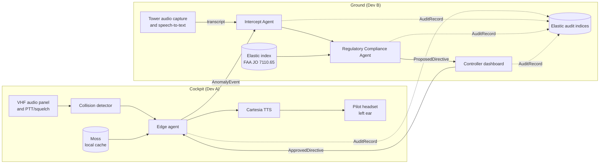
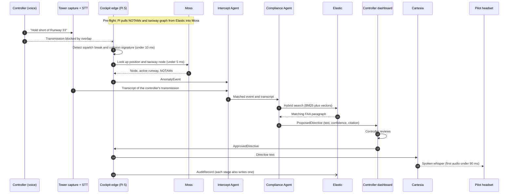

# Architecture

How data flows through Unstep, from the moment a transmission is stepped on to the final audit record.

| Field | Value |
| --- | --- |
| Status | Draft v0.1 |
| Last updated | 2026-10-23 |
| Related | [PRD](01-prd.md), [Work Split](04-work-split.md), [Research](06-research.md) |

## 1. System Overview

Solid lines are the live path. Dotted lines are audit writes, which never block the live path.

## 2. Data Flow, Start to Finish

## 3. Stage by Stage

| # | Stage | Where | Input | Output | Owner | Target |
| --- | --- | --- | --- | --- | --- | --- |
| 0 | Pre-flight sync | Pi | Elastic: NOTAMs, taxiway graph | Moss cache | A | Before pushback |
| 1 | Audio capture | Pi | Audio panel, PTT/squelch line | Audio frames | A | Continuous |
| 2 | Collision detection | Pi | Audio frames | Collision flag, duration | A | Under 10 ms |
| 3 | Local lookup | Pi (Moss) | Aircraft ID, GPS | Taxiway node, active runway | A | Under 5 ms |
| 4 | Event uplink | Pi to ground | Collision plus local state | `AnomalyEvent` | A | TBD (datalink) |
| 5 | Tower transcript | Ground | Controller audio | Instruction text | B | TBD |
| 6 | Intercept | Ground | `AnomalyEvent`, transcript | Matched event | B | TBD |
| 7 | Compliance check | Ground (Elastic) | Matched event | `ProposedDirective` | B | TBD |
| 8 | Human approval | Dashboard | `ProposedDirective` | `ApprovedDirective` | B | Human-paced |
| 9 | Directive downlink | Ground to Pi | `ApprovedDirective` | Directive on device | B | TBD (datalink) |
| 10 | Speech | Pi (Cartesia) | Directive text | Audio in left ear | A | Under 90 ms to first audio |
| 11 | Audit | Elastic | Every stage | `AuditRecord` | Both | Async |

## 4. Message Contracts

See [Work Split, section 3](04-work-split.md#3-shared-contracts-both-do-first) for the fields.

| Message | From | To |
| --- | --- | --- |
| `AnomalyEvent` | Edge agent | Intercept Agent |
| `ProposedDirective` | Compliance Agent | Controller dashboard |
| `ApprovedDirective` | Controller dashboard | Edge agent |
| `AuditRecord` | Every component | Elastic audit indices |

## 5. Failure Paths

| Failure | Behavior |
| --- | --- |
| No datalink to ground | Pi plays a local alert: "Transmission blocked, request say again" (M-003) |
| No tower transcript | Directive is not proposed. Dashboard shows "blocked transmission, content unknown" (M-002) |
| Low confidence or no rule match | Card is marked low confidence. The controller must reissue by voice |
| Controller rejects | Nothing is sent to the cockpit. The rejection is audited |
| Cartesia unavailable | Fall back to local TTS or pre-recorded phrases (M-004) |
