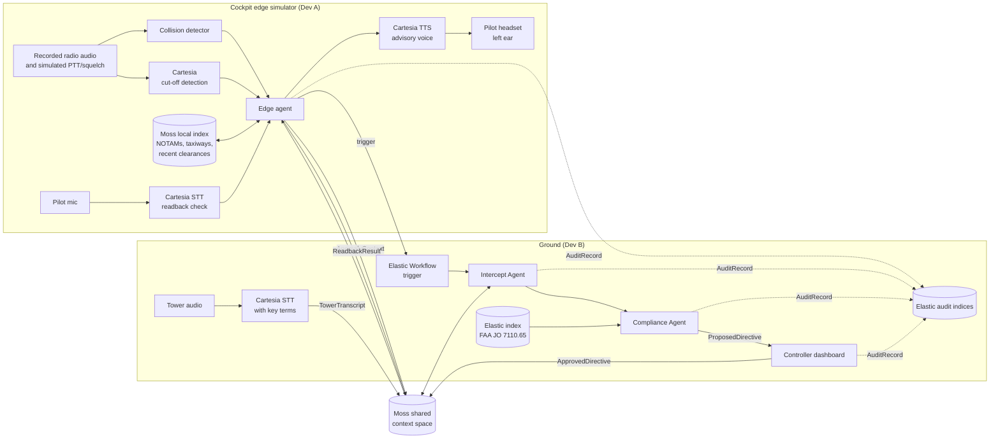
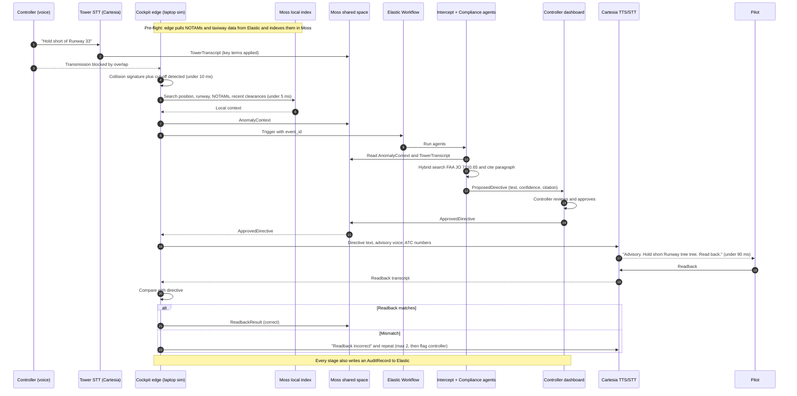

# Architecture

How data flows through Unstep, from the moment a transmission is stepped on to the final audit record.

| Field | Value |
| --- | --- |
| Status | Draft v0.2 |
| Last updated | 2026-10-23 |
| Related | [PRD](01-prd.md), [Work Split](04-work-split.md), [Research](06-research.md), [Sponsor Review](07-sponsor-review.md) |

> **Current scope:** Raspberry Pi integration is on hold. The cockpit edge runs as a software simulator on a laptop, using recorded radio audio and a simulated PTT/squelch signal. The data flow below stays the same when we move to the Pi later.

## 1. Design Principles

- **Agents share context, they don't chat.** Every agent reads and writes a shared Moss space. No agent sends conversational messages to another.
- **Voice runs the whole loop.** Cartesia transcribes the tower, detects cut-offs, speaks the directive and checks the readback.
- **Elastic orchestrates and remembers.** An Elastic Workflow runs the ground agents. Elastic holds the FAA rulebook and the audit trail.
- **A human approves every directive.**
- **Audit never blocks the live path.**

## 2. System Overview

Solid lines are the live path. Dotted lines are audit writes, which never block the live path.

**Fallback transport:** if Moss can't share one space between the edge and the ground machine (M-010), the same messages go over a WebSocket. The message formats don't change, only the transport.

## 3. Data Flow, Start to Finish

## 4. Stage by Stage

| # | Stage | Where | Input | Output | Owner | Target |
| --- | --- | --- | --- | --- | --- | --- |
| 0 | Pre-flight index | Edge sim (Moss) | Elastic: NOTAMs, taxiway graph | Moss local index | A | Before pushback |
| 1 | Audio capture | Edge sim | Recorded radio audio, simulated PTT/squelch | Audio frames | A | Continuous |
| 2 | Collision detection | Edge sim | Audio frames | Collision flag, duration | A | Under 10 ms |
| 3 | Cut-off detection | Edge sim (Cartesia) | Audio frames | Cut-off flag | A | TBD |
| 4 | Local search | Edge sim (Moss) | Aircraft ID, GPS | Runway, taxiway node, NOTAMs, recent clearances | A | Under 5 ms |
| 5 | Context handoff | Moss shared space | Collision plus local context | `AnomalyContext` | A | TBD |
| 6 | Tower transcript | Ground (Cartesia STT) | Controller audio | `TowerTranscript` | B | TBD |
| 7 | Workflow trigger | Elastic Workflow | `event_id` | Agents start | B | TBD |
| 8 | Intercept | Elastic agent | `AnomalyContext`, `TowerTranscript` | Matched event | B | TBD |
| 9 | Compliance check | Elastic agent | Matched event | `ProposedDirective` | B | TBD |
| 10 | Human approval | Dashboard | `ProposedDirective` | `ApprovedDirective` | B | Human-paced |
| 11 | Directive delivery | Moss shared space | `ApprovedDirective` | Directive on edge | Both | TBD |
| 12 | Speech | Edge sim (Cartesia TTS) | Directive text | Advisory audio in left ear | A | Under 90 ms to first audio |
| 13 | Readback check | Edge sim (Cartesia STT) | Pilot speech | `ReadbackResult` | A | TBD |
| 14 | Audit | Elastic | Every stage | `AuditRecord` | Both | Async |

## 5. Message Contracts

See [Work Split, section 3](04-work-split.md#3-shared-contracts-both-do-first) for the fields.

| Message | Written by | Read by |
| --- | --- | --- |
| `AnomalyContext` | Edge agent | Intercept Agent |
| `TowerTranscript` | Tower STT | Intercept Agent |
| `ProposedDirective` | Compliance Agent | Controller dashboard |
| `ApprovedDirective` | Controller dashboard | Edge agent |
| `ReadbackResult` | Edge agent | Dashboard, audit |
| `AuditRecord` | Every component | Elastic audit indices |

## 6. Failure Paths

| Failure | Behavior |
| --- | --- |
| No link to ground | Edge keeps indexing in Moss and plays a local alert: "Advisory. Transmission blocked, request say again" (M-003) |
| No tower transcript | No directive is proposed. Dashboard shows "blocked transmission, content unknown" (M-002) |
| Low confidence or no rule match | Card is marked low confidence. The controller must reissue by voice |
| Controller rejects | Nothing is sent to the cockpit. The rejection is audited |
| Readback wrong twice | Edge stops repeating and the dashboard flags the controller to reissue by voice |
| Cartesia unavailable | Fall back to local TTS or pre-recorded phrases (M-004) |
| Moss can't share across machines | Same messages over WebSocket (M-010) |
