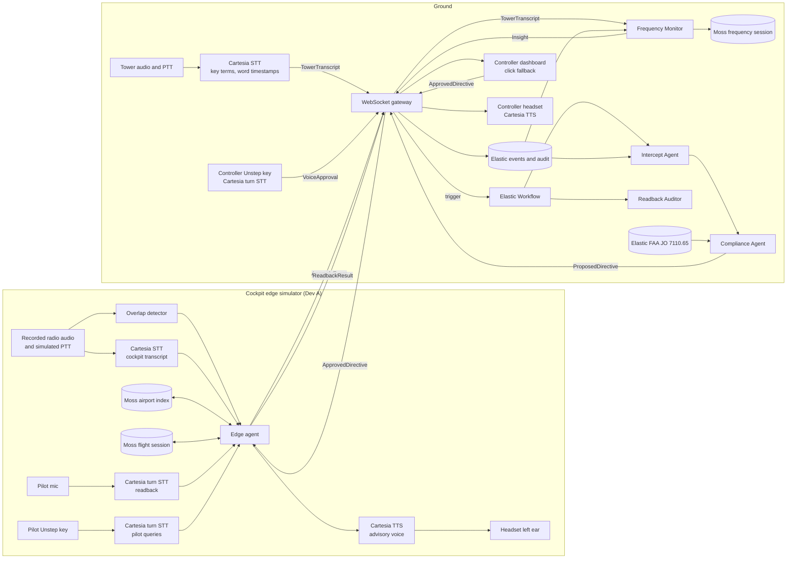
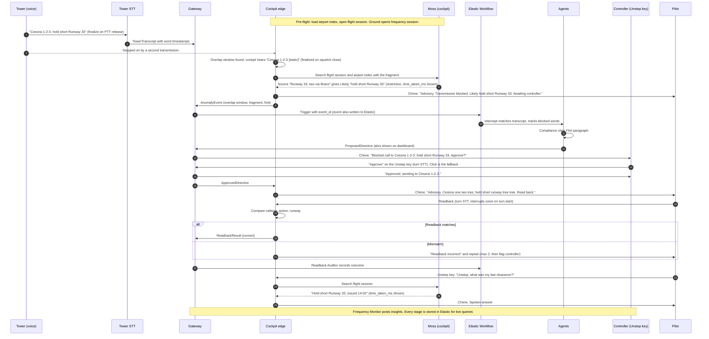

# Architecture

How data flows through Unstep, from a stepped-on or misheard instruction to the final audit record.

| Field | Value |
| --- | --- |
| Status | Draft v0.4 |
| Last updated | 2026-10-23 |
| Related | [PRD](01-prd.md), [Work Split](04-work-split.md), [Research](06-research.md), [Sponsor Review](07-sponsor-review.md), [Advice](08-advice.md) |

> **Current scope:** Raspberry Pi integration is on hold. The cockpit edge runs as a software simulator on a laptop, using recorded radio audio and a simulated PTT/squelch signal. The data flow stays the same when we move to the Pi later.

## At a Glance (demo view)

The simple picture for the pitch: one blocked call, left to right, one color per sponsor. The sections below have the detail, and [Agentic Architecture](10-agentic-architecture.md#2-demo-view-one-picture) has the same picture with what the audience sees or hears at each step.

```mermaid
flowchart LR
    A["1. Tower says<br/>hold short Runway 33<br/>but another call blocks it"]:::problem
    B["2. Cockpit Unstep notices<br/>Likely hold short<br/>found in memory"]:::moss
    C["3. Ground Unstep checks<br/>what the tower said<br/>and the FAA rule"]:::elastic
    D["4. Controller says<br/>Approve"]:::human
    E["5. Pilot hears it<br/>and reads it back<br/>wrong readback caught"]:::cartesia
    F["6. Dashboard and<br/>live stats"]:::elastic

    A --> B --> C --> D --> E
    E -.-> F

    classDef problem fill:#ffebee,stroke:#c62828,color:#1b1b1b
    classDef moss fill:#e8f5e9,stroke:#2e7d32,color:#1b1b1b
    classDef elastic fill:#e3f2fd,stroke:#1565c0,color:#1b1b1b
    classDef human fill:#f3e5f5,stroke:#6a1b9a,color:#1b1b1b
    classDef cartesia fill:#fff3e0,stroke:#ef6c00,color:#1b1b1b
```

## 1. Design Principles

- **Voice first.** The pilot and the controller both talk to Unstep on a separate Unstep key. Screens are backup and audit.
- **Only the Unstep key commands Unstep.** Radio speech is transcribed but never obeyed.
- **One clock.** All timestamps are epoch milliseconds from one clock. Tower word times are offsets from `ptt_start`.
- **Live messages go over WebSocket.** One gateway on the ground. Moss is not a message bus: handoff goes through Moss Cloud, `push_index()` replaces the whole index, and auto-refresh polls every 300 seconds.
- **Moss is local memory.** Each agent keeps its own Moss session. One writer per index. Handoff at clear points (end of an event, end of a flight).
- **Elastic is the ground's memory and orchestrator.** The gateway writes every message to an Elastic events index, so Agent Builder agents read from Elastic, not from Moss.
- **Voice runs both ways.** Cartesia transcribes tower and cockpit, speaks directives and listens to readbacks.
- **A human approves every directive.** The local hint is labeled "Likely" and is never a clearance.
- **Audit never blocks the live path.**

## 2. System Overview

Ownership: the cockpit box, the Moss frequency session and the Frequency Monitor belong to Dev A (all Moss, plus pilot voice queries). Everything else on the ground belongs to Dev B (all Elastic and tower STT). Controller voice approval (`unstep/ground/voice_approval.py`) was built by Dev A. The Frequency Monitor is the only writer to the Moss frequency session. See [Work Split](04-work-split.md#2-owners).

## 3. Data Flow, Start to Finish

## 4. Stage by Stage

| # | Stage | Where | Output | Owner | Target |
| --- | --- | --- | --- | --- | --- |
| 0 | Pre-flight | Cockpit, ground | Moss airport index loaded, flight and frequency sessions open | A | Before pushback |
| 1 | Tower transcript | Ground (Cartesia STT) | `TowerTranscript` with word timestamps | B | TBD after PTT release |
| 2 | Frequency indexing | Ground (Moss) | Transcript added to `freq-<frequency>` | A | Under 10 ms |
| 3 | Overlap detection | Cockpit | Overlap window | A | Under 10 ms |
| 4 | Cockpit transcript | Cockpit (Cartesia STT) | What the cockpit heard | A | TBD |
| 5 | Local hint | Cockpit (Moss) | "Likely ..." hint and search time | A | Under 10 ms |
| 6 | Event | Cockpit to gateway | `AnomalyEvent` | A | TBD |
| 7 | Store and trigger | Gateway, Elastic | Event in Elastic, Workflow started | B | TBD |
| 8 | Intercept | Elastic agent | Matched transcript, blocked words | B | TBD |
| 9 | Compliance | Elastic agent | `ProposedDirective` with FAA citation | B | TBD |
| 10 | Approval | Controller headset and Unstep key (dashboard click fallback) | `VoiceApproval`, then `ApprovedDirective` | B | Human-paced |
| 11 | Delivery | Gateway to cockpit (Cartesia TTS) | Advisory audio in left ear | A | Measure first audio |
| 12 | Readback | Cockpit (Cartesia turn STT) | `ReadbackResult` | A | TBD |
| 12a | Pilot query | Cockpit (Cartesia turn STT, Moss, Cartesia TTS) | Spoken answer, `PilotQuery` audit | A | Measure question to first audio |
| 13 | Readback audit | Elastic agent | Audit outcome | B | Async |
| 14 | Monitoring | Ground (Moss and Elastic) | `Insight` | A | Async |
| 15 | Audit | Elastic | ES\|QL audit and stats | B | Async |

## 5. Message Contracts

Fields are in [Work Split, section 3](04-work-split.md#3-shared-contracts-both-do-first). Every message goes over the WebSocket gateway, and the gateway writes it to the Elastic events index.

| Message | From | To |
| --- | --- | --- |
| `TowerTranscript` | Tower STT | Gateway, Frequency Monitor (which writes the Moss frequency session) |
| `AnomalyEvent` | Cockpit | Gateway, Workflow |
| `ProposedDirective` | Compliance Agent | Controller voice, dashboard |
| `VoiceApproval` | Controller Unstep key | Gateway |
| `ApprovedDirective` | Gateway (from voice or click) | Cockpit |
| `PilotQuery` | Cockpit | Gateway, Elastic (audit only) |
| `ReadbackResult` | Cockpit | Gateway, Readback Auditor, dashboard |
| `Insight` | Frequency Monitor | Dashboard, Elastic |
| `AuditRecord` | Every component | Elastic |

## 6. Moss Indexes

| Index | Kind | Writer | Readers | Handoff |
| --- | --- | --- | --- | --- |
| `airport-<ICAO>` | Long-term | Pre-flight setup | Cockpit, ground | Loaded with `load_index` before flight |
| `flight-<callsign>` | Cockpit session | Cockpit only | Ground and audit | `push_index()` at end of each event and end of flight |
| `freq-<frequency>` | Ground session | Frequency Monitor only | Frequency Monitor, ground services | Local only |

Moss does not compare readbacks. That is a slot comparison (callsign, action, runway) in our own code.

## 7. Failure Paths

| Failure | Behavior |
| --- | --- |
| No link to ground | Cockpit plays the pre-generated "Advisory. Transmission blocked, request say again" and keeps its local Moss session (M-003) |
| No tower transcript | No directive is proposed. Dashboard shows "blocked transmission, content unknown" (M-002) |
| No local hint found, or the guess is permissive | Cockpit says "Advisory. Transmission blocked. Awaiting controller." |
| Controller's spoken answer not understood | Unstep asks once more. No clear answer in 10 seconds: nothing is sent, the card stays on screen for a click |
| "Approve" heard on the radio frequency | Ignored. Only the controller's Unstep key counts |
| Pilot query has no match | "Advisory. No record found. Ask the controller." |
| Low confidence or no rule match | Card is marked low confidence. Controller reissues by voice |
| Controller rejects | Cockpit hears "request say again." The rejection is audited |
| Readback still wrong after 2 repeats | Cockpit stops repeating and the dashboard flags the controller |
| Cartesia unavailable | Pre-generated audio for fixed phrases, text on screen for the rest (M-004) |
| Agent Builder can't reach Moss | Agents read only from Elastic, which already has every message |
