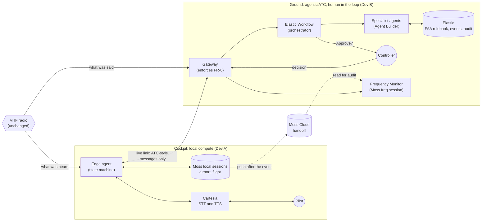
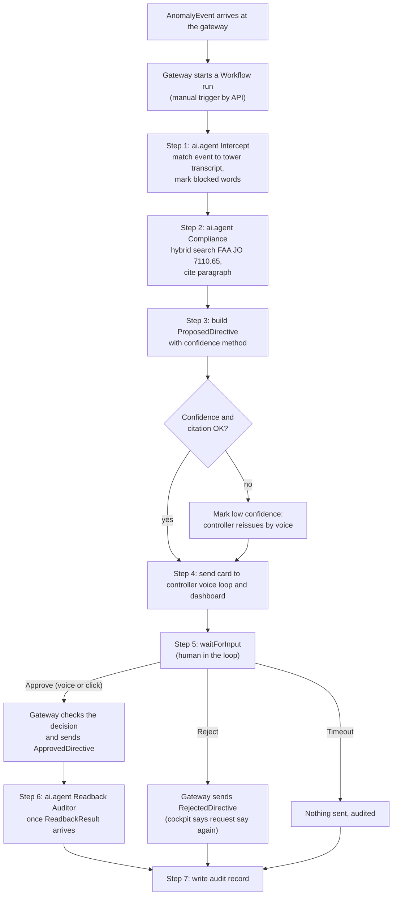
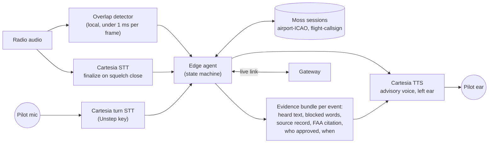
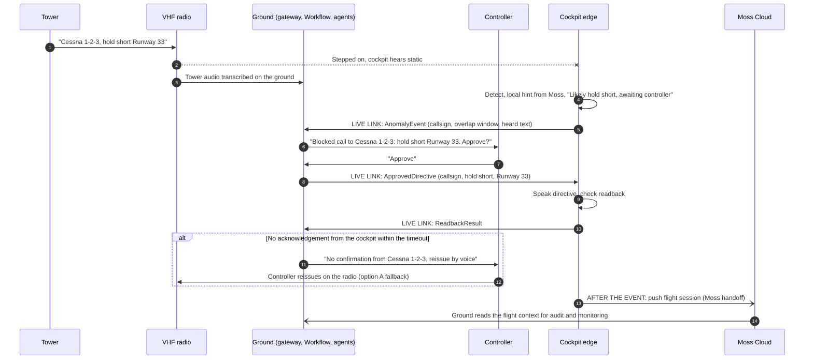

# Agentic Architecture: Ground ATC, Cockpit Edge and the Link Between Them

How the two halves of Unstep are organized as agents, where the human sits, and how information moves between the ground and the cockpit.

| Field | Value |
| --- | --- |
| Status | Proposal v0.1, needs Dev A's agreement before it changes the PRD |
| Last updated | 2026-10-23 |
| Related | [PRD](01-prd.md), [Architecture](05-architecture.md), [Work Split](04-work-split.md), [Research](06-research.md), [Mistakes](03-mistakes-and-lessons.md) |

## 1. Summary

1. **No boss agent.** The ground is orchestrated by an **Elastic Workflow**: a fixed, versioned sequence of steps written in YAML. The Workflow calls narrow specialist agents (Agent Builder, `ai.agent` step) and pauses for the human (`waitForInput` step). An LLM never decides which agent runs next.
2. **The human is the supervisor.** Agents propose, the Workflow sequences, the controller decides. The gateway enforces that nothing reaches the cockpit without that decision (FR-6).
3. **The cockpit works alone.** Detection, the local hint, speech, readback checks and pilot questions all run on local compute with Cartesia and Moss. The only thing it needs from the ground is the approved directive.
4. **Three channels, each for what it is good at:** the radio stays the shared voice channel, a live link carries only ATC-style messages, and Moss carries context handoff after the event. Moss is not the live channel (M-011).
5. **Share only what ATC already says.** Live messages carry the same content a controller would speak (callsign, instruction, runway, source), not raw audio or memory documents.

## 2. Demo View: One Picture

The simple version for the pitch. One blocked call, left to right, with each sponsor's part in its own color. Sections 3 to 7 have the detail.

```mermaid
flowchart LR
    A["1. Tower says<br/>hold short Runway 33<br/>but another call blocks it"]:::problem
    B["2. Cockpit Unstep notices<br/>Likely hold short<br/>found in memory"]:::moss
    C["3. Ground Unstep checks<br/>what the tower said<br/>and the FAA rule"]:::elastic
    D["4. Controller says<br/>Approve"]:::human
    E["5. Pilot hears it<br/>and reads it back<br/>wrong readback caught"]:::cartesia
    F["6. Dashboard and<br/>live stats"]:::elastic

    A --> B --> C --> D --> E
    E -.-> F

    classDef problem fill:#ffebee,stroke:#c62828,color:#1b1b1b
    classDef moss fill:#e8f5e9,stroke:#2e7d32,color:#1b1b1b
    classDef elastic fill:#e3f2fd,stroke:#1565c0,color:#1b1b1b
    classDef human fill:#f3e5f5,stroke:#6a1b9a,color:#1b1b1b
    classDef cartesia fill:#fff3e0,stroke:#ef6c00,color:#1b1b1b
```

| Step | What the audience sees or hears | Who does it |
| --- | --- | --- |
| 1 | A squeal over the tower's instruction | The problem |
| 2 | Pilot hears "Advisory. Transmission blocked. Likely hold short Runway 33. Awaiting controller." | Moss (local memory search, in milliseconds) |
| 3 | The blocked words and the FAA paragraph appear for the controller | Elastic (agents in a Workflow, hybrid search) |
| 4 | Controller says "Approve" | The human |
| 5 | Pilot hears the directive, reads back "Runway 23", Unstep catches it and repeats "Runway tree tree" | Cartesia (speech in and out) |
| 6 | Dashboard and a live ES\|QL query show the whole event | Elastic |

## 3. The Two Halves at a Glance

Solid lines are live. Dotted lines happen after the event and never block it.

## 4. Ground: Orchestrator, Agents and the Human

### 4.1 Why a Workflow and not a supervisor agent

| | LLM supervisor agent | **Elastic Workflow (proposed)** |
| --- | --- | --- |
| Who decides the next step | The LLM, at run time | Fixed YAML, reviewed in git |
| Same input, same path | Not guaranteed | Yes |
| Can skip the human | Possible if prompted badly | No: `waitForInput` is a fixed step and the gateway enforces FR-6 |
| Explainability | Reasoning trace in prose | Every step's input and output in the Workflow execution view in Kibana |
| Latency | Extra LLM call per routing decision | No routing calls |
| Elastic track | Uses Agent Builder | Uses Workflows, Agent Builder, hybrid search and ES\|QL together |

On a safety path the order of steps must not depend on a model's mood. LLMs are used only where language understanding is needed (matching a transcript, citing a rule), each inside one narrow agent with narrow tools.

Verified in the Elastic docs on 2026-10-23: Workflows have an `ai.agent` step that invokes an Agent Builder agent, an `ai.prompt` step, a `parallel` step (preview), a `waitForInput` step that pauses for human input, and manual triggers that can be run "through the UI or API" ([Steps](https://www.elastic.co/docs/explore-analyze/workflows/steps), [Triggers](https://www.elastic.co/docs/explore-analyze/workflows/triggers)). Still to verify in B5: the exact API path to start a run and to resume a `waitForInput` step.

### 4.2 One Workflow run per blocked call

The gateway stays the single enforcement point: it holds the proposal, accepts only a human decision, and builds the directive from the stored proposal. The Workflow records and sequences; it never talks to the cockpit directly. If the `waitForInput` resume API turns out not to fit, the fallback is two short runs: one that ends at the proposal, and one triggered by the decision.

### 4.3 Agents and their limits

| Agent | Kind | Reads | Writes | Tools it may use |
| --- | --- | --- | --- | --- |
| Intercept | `ai.agent` (Agent Builder) | Events index, tower transcripts | Match and blocked words | Search events index only |
| Compliance | `ai.agent` (Agent Builder) | FAA JO 7110.65 index | Citation and confidence | Hybrid search on FAA index only |
| Readback Auditor | `ai.agent` (Agent Builder) | Readback results, FAA readback rules | Audit outcome | Search FAA index only |
| Frequency Monitor | Python service (Dev A) | Tower transcripts, Moss `freq-<frequency>` | Insights | Moss search only, never sends to the cockpit |
| Controller voice loop | Python service (B10, being built by Rishit in `unstep/ground/voice_approval.py`) | Proposed directives | Human decision | Cartesia TTS and turn STT on the Unstep key |

No agent can send a directive. No agent talks to another agent: they hand results to the Workflow, which passes them on.

## 5. Cockpit: Local Compute with Cartesia and Moss

The edge agent is a state machine, not an LLM. It moves through fixed states (listening, blocked, hint given, awaiting approval, directive spoken, awaiting readback, confirmed or flagged) so its behavior can be tested and predicted.

### 5.1 Explainability (optional, cut if time is short)

Every advisory carries an evidence bundle. The pilot can ask "Unstep, why?" and hear, for example: "Your call from the tower at one four zero two was blocked. Controller approved hold short runway tree tree. Source: your taxi clearance at one three five eight." The same bundle drives the dashboard card and the audit record, so the cockpit, the controller and the inspector all see one explanation. It reuses the existing pilot query path (A10), Moss search and Cartesia TTS, so it adds no new component.

## 6. How Information Moves Between the Two Sides

### 6.1 Options

| Option | What moves | Speed | Verdict |
| --- | --- | --- | --- |
| A. Radio only: the controller just reissues by voice | Nothing new | Seconds | **Keep as the fallback.** It is what ATC does today, but the reissue can be stepped on again and the pilot gets no private advisory |
| B. Today's aircraft datalink (CPDLC) | Standard text messages | Bounded at 120 s at 95% and 150 s at 99.9% for RCP 240 CPDLC (research RA-5) | **Too slow for a live "hold short".** Fine for logging after the event |
| C. Moss handoff or in-session indexing | Whole Moss indexes via Moss Cloud | `push_index()` replaces the whole index, readers poll every 300 s by default (M-011) | **Not a live channel.** Right for context handoff after the event |
| D. Live link with ATC-style messages (proposed) | Small structured messages over WebSocket today, any IP link later | 9 ms gateway round trip measured in the live demo | **Use for the live path.** Content limited to what ATC already says |

### 6.2 Proposed: three channels

| Channel | Carries | When | Why this channel |
| --- | --- | --- | --- |
| VHF radio | Voice, as today | Always | Unchanged. Both sides transcribe it independently, so the tower transcript never has to travel to the cockpit |
| Live link | `AnomalyEvent`, `ApprovedDirective`, `RejectedDirective`, `ReadbackResult`, `PilotQuery` | During the event | Fast and small. Demo: WebSocket. Real product: an IP link on the airport surface (to research, RA-5) |
| Moss handoff | Flight session (clearances, readbacks, events) | After the event, end of flight | Moss's own handoff pattern: one writer, push, then read |
| Elastic | Every message and every Workflow step | Always, asynchronously | Audit and stats, never blocks the live path |

### 6.3 Share only what ATC already shares

The live link carries the same information a controller would put on the radio, in the same structure, plus ids to tie the event together. It never carries raw audio, Moss documents or anything a controller would not say.

| Sent over the live link | Never sent over the live link |
| --- | --- |
| Callsign, instruction (action, runway or taxiway), source of the instruction, event id, overlap window, what the cockpit heard | Raw cockpit or tower audio |
| Who approved and how (voice or click) | Moss documents or embeddings |
| Readback text and match result | The pilot's other questions and answers (they stay in the flight session until handoff) |

Proposed change for discussion: `AnomalyEvent` currently also sends `gps`. The taxiway node is enough for the ground to check the instruction, so `gps` could be dropped to keep to this rule. This is a contract change and needs both developers to agree (CLAUDE.md).

## 7. Open Items

| Item | Owner | How we close it |
| --- | --- | --- |
| API path to start a Workflow run and resume `waitForInput` | Dev B (B5) | Read the Workflows API reference, test on our Kibana |
| Latency of `ai.agent` steps | Dev B (B5, B9) | Measure; if too slow, run Intercept and Compliance in `parallel` |
| Drop `gps` from `AnomalyEvent` | Both | Agree, then change `unstep/contracts.py` and log it |
| Cockpit acknowledgement timeout before "reissue by voice" | Both | Pick a value, add it to the gateway |
| Real-product live link on the airport surface | Dev A (RA-5) | Source typical latency for airport Wi-Fi, cellular or gatelink |
| "Unstep, why?" explainability | Dev A (A10) | Only after the demo flow works |
| Blocked-word timing for the Intercept step | Dev B (B2, B3) | Cartesia ink-2 gives key terms but no word timestamps, ink-whisper gives word timestamps but no key terms (Rishit's live tests, [Cartesia feedback](09-cartesia-feedback.md)). Use ink-2 for the text and ink-whisper for the timing |
