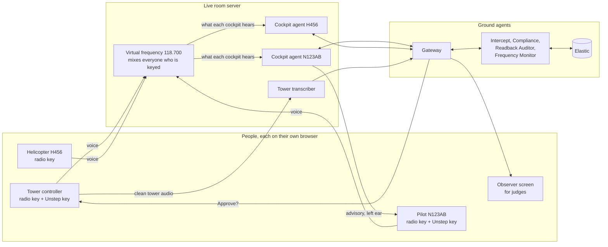

# Live Demo: A Shared Radio Room Anyone Can Join

How to turn the scripted presenter into a real, multi-person demo: each person joins from their own device, takes a role, and talks on a shared virtual radio frequency. Blocked transmissions happen for real when two people talk at once, and everything after that runs live.

| Field | Value |
| --- | --- |
| Status | Built (v0.2): live room, policy agent, role screens. The policy rule change needs Dev A's agreement |
| Last updated | 2026-10-24 |
| Related | [PRD](01-prd.md), [Agentic Architecture](10-agentic-architecture.md), [Work Split](04-work-split.md), [Architecture](05-architecture.md) |

## 0. How to Run It

```
python -m unstep.live              # LIVE when CARTESIA_API_KEY is set, opens http://127.0.0.1:8765/live/
python -m unstep.live --offline    # fake speech, no API calls
python -m unstep.live --host 0.0.0.0 --port 8765   # others on the same network (see the printed link)
```

1. Every person opens the link and picks a seat: tower controller, Cessna N123AB, Helicopter H456 or the observer screen.
2. The tower transmits: type in the say box, click a suggested line, or hold Space to talk where the microphone is allowed.
3. Someone else transmits at the same time, and the call is stepped on for real.
4. Watch the agents on the controller and observer screens. Routine restrictive calls are relayed by the policy agent. Edge cases land in "Needs you" with the reasons and a countdown.

| What | Real or stand-in |
| --- | --- |
| Shared frequency, overlap, AM beat tone, radio truth | Real (`unstep/live/radio.py`) |
| Cockpit overlap detector, local hint, advisory voice, readback check, pilot questions | Real (Rishit's cockpit agent, one per aircraft) |
| Tower transcript and cockpit transcript | Real Cartesia STT in live mode |
| Speech from the say box | Real Cartesia TTS in each station's voice |
| Ground agents (intercept, compliance) | Stand-in (`unstep.ground.mock_agents.propose`) until the Elastic Workflow (B5) |
| Policy agent, gateway rules, Elastic storage | Real |
| Moss | Real for N123AB, local memory for H456 (Moss plan limit) |

Checked live on 2026-10-24 with four headless browser seats on real Cartesia. A hold short stepped on by the helicopter was auto-relayed and spoken. A wrong readback ("runway two three") was caught and the correct one confirmed. A stepped-on "cleared for takeoff" was escalated with two reasons and rejected by the controller, and the pilot heard "request say again".

### Known limits

- Directives are still broadcast to every cockpit agent, and each agent keeps only its own callsign. Per-aircraft routing in the gateway is still to do (L2).
- The H456 cockpit agent uses the N123AB seed data, so its local hints are not meaningful yet (L4, Dev A).
- Microphones need `https` or `localhost`. The say box works everywhere.
- Room history lives in memory and resets when the server restarts. Elastic keeps every message.

## 1. Why Change the Presenter Mode

| Today (presenter mode) | Problem |
| --- | --- |
| Recorded clips play a scripted call and a scripted overlap | Judges watch a recording, not a system. "Is it real?" is the first question they will ask |
| One laptop drives every role | Nobody but the presenter can try it |
| Scenes advance on "Next" | A proposal can expire (60 s TTL) while the presenter talks, which is the likely cause of "Scene failed (RuntimeError)" in the controller scene |
| One aircraft | No multi-aircraft story, no queue for the controller |

The presenter mode stays as the backup when the hall is too noisy or the network fails.

## 2. The Idea: A Live Radio Room



1. **One shared frequency.** Every radio transmission goes to the room server, which mixes everyone who is keyed at that moment and plays the mix to every station, like real VHF. If the controller and the helicopter pilot talk at the same time, every cockpit hears the overlap. Nothing is pre-recorded.
2. **One cockpit agent per aircraft.** Each pilot station gets its own cockpit agent (the existing `CockpitEdge`) fed with what that aircraft heard, with its own Moss flight session.
3. **The tower's own audio is clean.** The controller's microphone also goes straight to the tower transcriber, so the ground knows what was actually said (M-002).
4. **The human decides.** The controller hears each proposal and answers on a separate Unstep key, or clicks. Nothing reaches a cockpit without that decision.
5. **Every step is explained.** The observer screen shows the evidence for each event as it happens (section 5).

## 3. Roles for Three or More People

| Role | Who | Device | Talks on | Sees |
| --- | --- | --- | --- | --- |
| Tower controller | Teammate or judge | Laptop or phone with headset | Radio key (clearances), Unstep key ("Approve", "Reject") | Proposal queue with countdowns, evidence per card |
| Pilot N123AB | Judge | Phone or laptop with headset | Radio key (readbacks), Unstep key ("Unstep, why?", "what was my last clearance?") | Advisories as text and speech (left ear), readback result |
| Helicopter H456 | Second judge or teammate | Phone | Radio key only | Its own advisories |
| More aircraft (optional) | Anyone | Phone | Radio key | Their own advisories |
| Observer | Big screen | Laptop on the projector | Nothing | Live timeline, explanations, agent steps, Elastic stats |

Each person opens the room link, picks a role, and is ready. The room shows who is connected.

**No microphone, or a noisy hall:** every station has a "say" box. Typed text is spoken by Cartesia in that station's voice and sent onto the frequency as a real transmission, so overlaps, transcription and everything after still run live. Typing at the same moment on two stations still produces a real overlap.

## 4. Demo Flow (about 3 minutes, then free play)

| # | Who | Action | What the room shows |
| --- | --- | --- | --- |
| 1 | Everyone | Join from phones, pick roles | Observer shows four stations connected |
| 2 | Tower | Keys the radio: "Cessna 1-2-3, hold short Runway 33" | Tower transcript appears on the observer |
| 3 | Helicopter | Keys at the same time: "Helicopter 4-5-6, request transition" | Overlap marked on both waveforms, blocked words struck through |
| 4 | Pilot N123AB | Hears the squeal, then the chime: "Advisory. Transmission blocked. Likely hold short Runway 33. Awaiting controller." | Hint card with the Moss search time and source record |
| 5 | Tower | Hears "Blocked call to Cessna 1-2-3: hold short Runway 33. Approve?" and says "Approve" on the Unstep key | Decision, who made it, how (voice), and latency |
| 6 | Pilot N123AB | Hears the directive, reads back "Runway 23" on the radio | "Readback incorrect. Runway tree tree." Then the correct readback is confirmed |
| 7 | Pilot N123AB | Unstep key: "Unstep, why?" | Spoken explanation from the evidence chain |
| 8 | Judges | Free play: any two people talk over each other, or type in the say box | Every new event runs the same path |
| 9 | Observer | Live ES\|QL: blocked calls and readback errors by aircraft | Elastic stats for the session |

Two aircraft stepped on at once produce two cards in the controller's queue. Each card has its own countdown, and each decision reaches only its own aircraft.

## 5. Explainability: The Evidence Chain

Every event gets one evidence chain, built as it happens and stored in Elastic. The observer screen, the controller's card, the pilot's "Unstep, why?" and the audit record all read the same chain, so everyone sees one explanation.

| Link | Evidence | From |
| --- | --- | --- |
| What was said | Tower transcript with word timings | Tower transcriber (Cartesia) |
| What was heard | Cockpit transcript | Cockpit agent (Cartesia) |
| Why it is "blocked" | Overlap window, which stations were keyed, words inside the window | Room mixer and cockpit agent |
| Why the hint | Moss source record, search time, restrictive-only rule | Cockpit agent (Moss) |
| Why the directive | Matched transcript, FAA paragraph, confidence and how it was computed | Intercept and Compliance agents (Elastic) |
| Who decided | Controller, voice or click, time to decide, what was repeated back | Controller voice loop and gateway |
| Was it understood | Readback text, slot comparison, attempts | Cockpit agent |

Each agent step shows its input, output and time, so a judge can follow one blocked call from the squeal to the confirmed readback.

## 6. Human in the Loop with Several Aircraft

**Built as a policy agent** (`unstep/ground/policy.py`). The controller is needed only for edge cases: the policy auto-relays a blocked instruction only when the agents can show it repeats the controller's own words. All of these must pass, otherwise the call goes to "Needs you" with the failed checks as reasons:

| Check | Passes when |
| --- | --- |
| tower_transcript | The ground heard the controller's own transmission |
| addressed | That transmission was addressed to this aircraft |
| fresh | The controller spoke within `UNSTEP_AUTO_MAX_AGE_S` (default 30 s) |
| restrictive | The instruction makes the aircraft wait (hold short, hold position, stop, go around) |
| confidence | The agents rated the match high |
| hint_agrees | The cockpit's local hint does not contradict it |
| autonomy_on | The controller has not switched auto-relay off |

The gateway re-checks every auto approval (restrictive, high confidence) and rebuilds it from the stored proposal. The policy role can approve but never reject. This changes PRD rule FR-6 and needs Dev A's agreement.

- **Queue, not a single card.** Proposals line up per aircraft. The controller hears them one at a time, oldest first, with the callsign said first.
- **Visible countdown.** Each card shows how long until it expires, which removes the "proposal expired while I was talking" failure.
- **Per-aircraft delivery.** The gateway sends a directive only to the cockpit it is for (planned gateway change, see section 8).
- **Never automatic.** No auto-approver in the live room. Silence or "unclear" sends nothing, and the card says so.

## 7. Technical Notes

| Topic | Approach |
| --- | --- |
| Microphones in the browser | Browsers only allow the mic on `https` or `localhost`. Run the room behind an HTTPS tunnel, or give each laptop `localhost` access; the say box works everywhere |
| Audio format | 16 kHz mono PCM, 100 ms frames, the format the cockpit agent and Cartesia already use |
| Radio mixing | Sum the frames of every keyed station each 100 ms; record which stations were keyed per frame, so the overlap is known exactly, not only guessed from audio |
| Cockpit agents | One `CockpitEdge` per aircraft, fed one finished transmission at a time through `ArraySource`, so the existing code works without a streaming rewrite |
| Turn-taking | Radio key held means transmitting. Unstep key is separate and never goes on the frequency |
| Moss | One flight session per aircraft. Needs the Moss plan to allow more than 3 indexes (still 3 of 3 on the last screenshot) |
| Latency | One live run showed a 5.4 s cockpit transcript finalize and 552 ms first audio. Measure in the hall, and keep the say box as the reliable path |

## 8. Build Plan

| Step | What works | Owner |
| --- | --- | --- |
| L1 | Room server with the virtual frequency, role pages, say box, two aircraft, controller click approval, observer timeline | Dev B |
| L2 | Per-aircraft directive routing in the gateway, controller queue with countdowns | Dev B |
| L3 | Push-to-talk microphones over HTTPS, controller voice approval in the room | Dev B with Dev A (voice loop) |
| L4 | Cockpit agent per aircraft with its own Moss session, seed data for a second aircraft, "Unstep, why?" | Dev A |
| L5 | Evidence chain in Elastic, observer explanation view, live ES\|QL panel | Dev B |
| L6 | Real Elastic agents (B4, B5) replace the mock ground agents | Dev B |

L1 and L2 give a working live room with real overlaps and a human in the loop. L6 is still the critical path for the Elastic track and runs alongside.

## 9. Open Questions

| Question | Who |
| --- | --- |
| Run on one laptop with several browser windows, or on everyone's phones over an HTTPS tunnel? | Both |
| Does the presenter mode stay as a separate backup, or become a "replay" of a recorded live session? | Both |
| Moss plan upgrade for more than one aircraft | Rishit |
| Which voices for tower, pilots and the advisory voice (`CARTESIA_VOICE_ID`) | Rishit |
